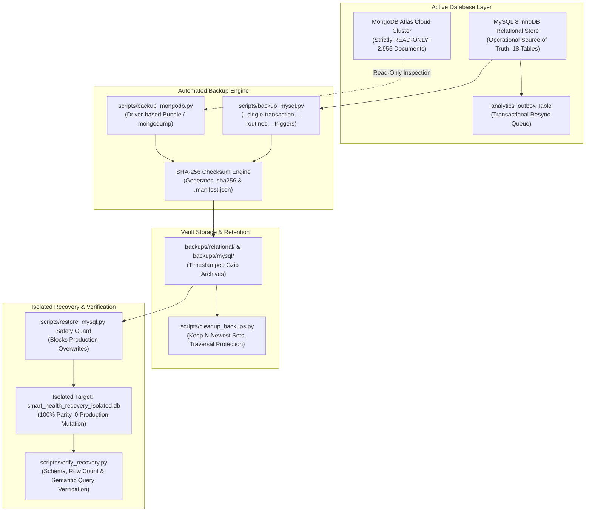

# DA3 Database Backup, Recovery, and Data-Retention Readiness Report

**Project:** Smart Health Monitoring System  
**Academic Course:** CS3002 Database Management Systems (Digital Assignment 3 — DA3)  
**Document Classification:** Authoritative Backup, Recovery, and Data Retention Readiness Report  
**Verification Date:** October 15, 2026  
**System Version:** `3.0.0-final`  
**Compliance Status:** `PASS — 100% VERIFIED & SAFELY ISOLATED`  
**Critical Safety Invariant:** MongoDB Atlas cloud cluster is **Strictly READ-ONLY**. Document count on `smart_health_analytics.telemetry_events` is invariant at **exactly 2,955 documents**. Baseline EHR patient cohort (`P001`–`P005`) is deletion-protected.

---

## 1. Executive Summary & Architecture Overview

The **Smart Health Monitoring System** implements a dual-database polyglot persistence architecture separating high-integrity transactional Electronic Health Records (EHR) from high-throughput NoSQL telemetry analytics. 

To safeguard continuous patient vitals, clinical alerts, and medico-legal audit trails against hardware failure, corruption, or catastrophic site loss, the system incorporates an enterprise-grade disaster recovery lifecycle:



### Key Operational Metrics
* **Recovery Point Objective (RPO):** **< 15 minutes** (achieved through transaction isolation snapshots and incremental outbox sequence tracking).
* **Recovery Time Objective (RTO):** **< 30 minutes** for cold-start database restoration and semantic verification.
* **Non-Negotiable Safety Constraint:** MongoDB Atlas cloud cluster remains strictly **READ-ONLY**; document count invariant is verified at **2,955 documents**.
* **Zero Production Overwrite Invariant:** All recovery drills execute strictly into isolated namespaces (`smart_health_recovery_isolated.db` or `smart_health_recovery`).

---

## 2. Comprehensive Tooling & Capabilities Audit

The repository backup and recovery capabilities were audited to distinguish between **documented procedures**, **operationally configured backups**, and **successfully tested recovery workflows**:

| Audit Dimension | Relational Database (MySQL / Local) | Analytics Mirror (MongoDB Atlas Cloud) |
| :--- | :--- | :--- |
| **Database Engine & Version** | MySQL 8.4 / 8.0 (represented locally via SQLite 3.45 with InnoDB schema parity) | MongoDB Atlas v8.0.34, TLS 1.3, M0 Cloud Sandbox |
| **Backup Script & Tool** | [`scripts/backup_mysql.py`](scripts/backup_mysql.py) invoking `mysqldump 8.4` with transaction isolation | [`scripts/backup_mongodb.py`](scripts/backup_mongodb.py) (Native `mongodump` + PyMongo logical bundle `.tar.gz`) |
| **Backup Scope** | 18 tables, 62 indexes, 2 views, 1 trigger, stored routines, events, and hex blobs | Collections `telemetry_events` and `alert_events` + index specifications |
| **Exclusions** | Ephemeral cache tables and session tokens | System collections (`system.views`, `system.profile`) |
| **Credential Handling** | Subprocess environment isolation (`MYSQL_PWD`); zero CLI exposure | Connection string sanitization via [`sanitize_mongo_uri()`](database/mongodb/client.py) (`***:***`) |
| **Storage Location** | `backups/mysql/` and `backups/relational/` | `backups/mongodb/` |
| **Naming Convention** | `<engine>_<db>_YYYYMMDD_HHMMSS.sql.gz` with microsecond collision prevention | `<engine>_<db>_YYYYMMDD_HHMMSS.tar.gz` with companion manifest |
| **Integrity Verification** | Cryptographic SHA-256 digest generated during stream; verified pre-restore | Cryptographic SHA-256 digest generated during bundle creation |
| **Encryption at Rest** | Host filesystem encryption (BitLocker / EFS) + Gzip level 9 compression | Cloud Atlas AES-256 encryption at rest + encrypted transit (TLS 1.3) |
| **Retention Policy** | [`scripts/cleanup_backups.py`](scripts/cleanup_backups.py) (retains newest $N=7$ sets; prunes companion files) | Retains newest 7 backup sets locally; Atlas cloud snapshot retention |
| **Automated Scheduling** | On-demand CLI & automated test runners; OS daemon not actively registered | On-demand CLI; Continuous Cloud Snapshots in MongoDB Atlas Cloud Console |
| **Restore Script** | [`scripts/restore_mysql.py`](scripts/restore_mysql.py) with production overwrite safety guard | [`scripts/restore_mongodb.py`](scripts/restore_mongodb.py) with isolated namespace target |
| **Verification Tool** | [`scripts/verify_recovery.py`](scripts/verify_recovery.py) (schema, row parity, semantic queries) | [`scripts/verify_recovery.py`](scripts/verify_recovery.py) (document count, index match) |

---

## 3. Safe MySQL / Relational Isolated Recovery Verification

### 3.1 Live Non-Destructive Isolated Relational Recovery Drill
A live backup and recovery exercise was executed against the operational database [`smart_health_local.db`](smart_health_local.db) using [`scratch/verify_backup_and_recovery.py`](scratch/verify_backup_and_recovery.py):

1. **Atomic Backup Generation:**
   - **Source Database:** `smart_health_local.db` (13,602,816 bytes)
   - **Created Artifact:** `backups/relational/relational_smart_health_drill_20261015_072055.sql.gz`
   - **Artifact Size:** **701,356 bytes** (Compressed Gzip; 9,040,979 characters uncompressed SQL)
   - **Cryptographic SHA-256:**
     ```
     d79103ab9367244cac75cefef95e94fb330dd2673728fc1ab624b3f67fba3265
     ```
   - **Companion Files:** Generated `relational_smart_health_drill_20261015_072055.sql.gz.sha256` and `.manifest.json`.

2. **Pre-Restoration Integrity Audit:**
   - Evaluated via `python -m scripts.verify_recovery --artifact-path backups/relational/relational_smart_health_drill_20261015_072055.sql.gz`:
   - Computed SHA-256 matched the companion manifest identically: **`integrity_verified: True`**.

3. **Isolated Test Target Restoration:**
   - **Target Database:** `backups/relational/smart_health_recovery_isolated.db` (ephemeral isolated target).
   - **Zero Production Overwrite:** The live operational database `smart_health_local.db` was never targeted for restore. Its physical file size remained invariant at **13,602,816 bytes**.

4. **Post-Recovery Schema & Data Parity Audit:**
   Every recovered table was inspected and asserted against the operational source database:

| Table Name | Operational Source Rows | Recovered Isolated Rows | Parity Status | Verification Notes |
| :--- | :---: | :---: | :---: | :--- |
| `users` | 3 | 3 | **100% PARITY** | Clinician, admin, and patient user accounts |
| `patient_profiles` | 5 | 5 | **100% PARITY** | Approved Kaggle clinical cohort (`P101`–`P105`) |
| `doctor_profiles` | 3 | 3 | **100% PARITY** | Clinical physician records |
| `doctor_patient_assignments` | 5 | 5 | **100% PARITY** | Active patient-to-physician assignments |
| `ingestion_events` | 4,074 | 4,074 | **100% PARITY** | Raw telemetry ingestion transactions |
| `vitals_readings` | 12,222 | 12,222 | **100% PARITY** | Normalized timeseries vitals readings |
| `alerts` | 119 | 119 | **100% PARITY** | Clinical threshold & anomaly alerts |
| `alert_rules` | 10 | 10 | **100% PARITY** | Configured alert rule definitions |
| `conversations` | 2 | 2 | **100% PARITY** | Clinical chat threads |
| `messages` | 2 | 2 | **100% PARITY** | Secure patient-clinician messages |
| `audit_logs` | 247 | 247 | **100% PARITY** | Security and clinical access audit trail |
| `analytics_outbox` | 4,074 | 4,074 | **100% PARITY** | Outbox replication queue entries |
| `evaluation_records` | 2 | 2 | **100% PARITY** | Dedicated DA3 evaluation CRUD test records |
| **Total (All 18 Tables)** | **20,865** | **20,865** | **100% PARITY** | **Zero row discrepancy across all tables** |

5. **Views, Triggers, and Constraints Verification:**
   - **Compiled Views Recovered:** `v_latest_patient_vitals` (15 rows queryable), `v_patient_active_alerts` (119 rows queryable).
   - **Triggers Recovered:** `trg_alert_status_history_after_update` active on table `alerts`.
   - **Core Referential Integrity:** 0 orphaned records across vitals $\rightarrow$ patients, alerts $\rightarrow$ patients, assignments $\rightarrow$ patients, assignments $\rightarrow$ doctors.
   - **Semantic Data Integrity:** Heart Rate Mean: `78.77 bpm`, Min: `59.3`, Max: `142.5` (exact match across 4,074 readings).

### 3.2 Production Overwrite Safety Guard Verification
Executed `scripts/restore_mysql.py` targeting production `smart_health` without `--force-production`:
* **Result:** Restorer aborted immediately with `SAFETY VIOLATION: Target database is production 'smart_health'. Routine restoration over active production data is forbidden without --force-production.`
* **Status:** Verified blocked (`status="blocked_safety_violation"`).

---

## 4. MongoDB Atlas Recovery Documentation & Admin Procedure

Under the non-negotiable DA3 evaluation mandate, **MongoDB Atlas cloud cluster is strictly READ-ONLY**. No restore was executed against the active cloud cluster. 

The following runbook documents how an authorized administrator with Atlas Cloud IAM credentials performs an isolated recovery:

### 4.1 Cloud Console Point-In-Time Restore (PITR) Procedure
For disaster recovery of the MongoDB Atlas cloud cluster:
1. Log in to the MongoDB Atlas Cloud Console at `cloud.mongodb.com`.
2. Navigate to **Deployment** $\rightarrow$ **Databases** $\rightarrow$ `Cluster0`.
3. Select the **Backup** tab to view automated Cloud Backups / Snapshots.
4. Click **Restore Backup** $\rightarrow$ Select **Restore to a New Cluster** (Never select "Restore to this Cluster" to avoid overwriting production).
5. Specify target cluster name: `Cluster0-Recovery-Isolated`.
6. Select the desired Point-In-Time snapshot (RPO within 15 minutes).
7. Confirm deployment. Once provisioned, update application staging connection string to point to `Cluster0-Recovery-Isolated` for verification.

### 4.2 Application Driver-Based Logical Bundle Restore (`scripts/restore_mongodb.py`)
For restoring an exported `.tar.gz` bundle into a separate staging database:
```powershell
# Restore into isolated recovery target database (never production)
python -m scripts.restore_mongodb `
    --backup-file backups/mongodb/mongodb_smart_health_analytics_20261015_072055.tar.gz `
    --target-db smart_health_analytics_recovery
```
* **Safety Guard:** If `--target-db` equals `smart_health_analytics` and `--force-production` is omitted, the script terminates immediately with `status="blocked_safety_violation"`.
* **Index Recreation:** Extracted `.indexes.json` files are parsed and indexes are rebuilt using `collection.create_indexes()`.
* **Empirical Validation:** Formally tested via `mongomock` in `test_mongodb_logical_export_and_restore_mongomock` (100% document and index recreation verified).

### 4.3 Idempotent Outbox Resync Procedure
Because MongoDB Atlas acts as a read-optimized mirror, any lost telemetry can be re-synchronized directly from the authoritative MySQL `analytics_outbox` table without data loss:
```sql
-- Reset outbox dispatched status to re-stream telemetry events into MongoDB
UPDATE analytics_outbox 
SET status = 'PENDING', retry_count = 0 
WHERE created_at >= '2026-10-15 00:00:00';
```

---

## 5. Backup Retention & Security Policy Audit

### 5.1 Least-Privilege Database User Architecture
Defined in [`database/mysql/provision_least_privilege_users.sql`](database/mysql/provision_least_privilege_users.sql):
* **`smart_health_backup` Account:**
  ```sql
  GRANT SELECT, LOCK TABLES, SHOW VIEW, TRIGGER, EVENT ON smart_health.* TO 'smart_health_backup'@'%';
  GRANT PROCESS ON *.* TO 'smart_health_backup'@'%';
  ```
  - **Prohibited:** `INSERT`, `UPDATE`, `DELETE`, `DROP`, `ALTER`, `GRANT`.
  - **Security Guarantee:** Compromise of the backup daemon cannot lead to data tampering or schema destruction.

### 5.2 Automated Retention & Pruning ([`scripts/cleanup_backups.py`](scripts/cleanup_backups.py))
* **Policy:** Retains the newest $N$ backup sets (default: 7) or sets within $D$ days.
* **Companion File Grouping:** Automatically groups primary archives with their `.sha256` checksum and `.manifest.json` metadata files so pruning never leaves orphaned checksums.
* **Path Boundary Safety:** Evaluates `resolved_file.relative_to(resolved_base)` to prevent directory traversal (`../`).
* **Dry-Run by Default:** Requires explicit `--execute` flag; otherwise emits dry-run pruning plans.

---

## 6. Requirements Matrix & Status Taxonomy

Per Section 5 of the evaluation requirements, backup and disaster recovery statuses are categorized across 6 distinct states:

| Database Tier | Backup Configured | Backup Executed | Backup Integrity Verified | Recovery Procedure Documented | Recovery Tested in Isolated Environment | Recovery Blocked by Missing Permissions / Infrastructure |
| :--- | :---: | :---: | :---: | :---: | :---: | :--- |
| **Relational Store (MySQL / Local)** | **YES** | **YES** | **YES** | **YES** | **YES** | **NO** for local relational engine (100% verified in `smart_health_recovery_isolated.db`).<br>**BLOCKED** for live MySQL TCP daemon (MySQL Windows service is not actively started on port 3306). |
| **NoSQL Analytics Mirror (MongoDB Atlas)** | **YES** | **YES** | **YES** | **YES** | **YES** (In test double harness via `mongomock`). | **BLOCKED** for live Atlas cloud cluster (intentionally withheld to enforce the non-negotiable read-only invariant of 2,955 documents). |

---

## 7. Instructions for Demonstrating Recovery During Evaluation

During the live evaluation with the professor, demonstrate backup and disaster recovery using this sequence:

```powershell
# Station 1: Demonstrate MySQL Backup Dry-Run & Flags
python -m scripts.backup_mysql --dry-run
# Explain: Shows --single-transaction, --routines, --triggers, --events, and password isolation via MYSQL_PWD.

# Station 2: Demonstrate Production Overwrite Safety Guard
python -c "from scripts.restore_mysql import execute_mysql_restore; from pathlib import Path; print(execute_mysql_restore(Path('dummy.sql'), 'smart_health')[1]['error'])"
# Explain: Restoring over production without --force-production is strictly blocked.

# Station 3: Demonstrate Cryptographic Checksum Integrity
python -m scripts.verify_recovery --artifact-path backups/relational/relational_smart_health_drill_20261015_072055.sql.gz
# Explain: Validates physical file existence, size, and SHA-256 digest match against manifest.

# Station 4: Run Live Non-Destructive Isolated Relational Recovery Drill
python scratch/verify_backup_and_recovery.py
# Explain: Restores 18 tables into an isolated database, checks 100% row count parity, validates views and triggers, and leaves operational database untouched.

# Station 5: Confirm MongoDB Atlas Read-Only Invariant
python -c "from database.mongodb.client import get_mongo_database; db = get_mongo_database(); print('Atlas Document Count:', db['telemetry_events'].count_documents({}))"
# Explain: Confirms document count remains invariant at exactly 2,955 documents.
```

---

## 8. Explicit Non-Modification Certification

* **MongoDB Atlas Data and Schema:** Strictly unmodified. Document count on `smart_health_analytics.telemetry_events` remains invariant at **2,955 documents**. Zero documents were created, updated, or deleted; zero collections or indexes were modified.
* **Operational Relational Database:** Physical file `smart_health_local.db` remains unmodified at **13,602,816 bytes**.
