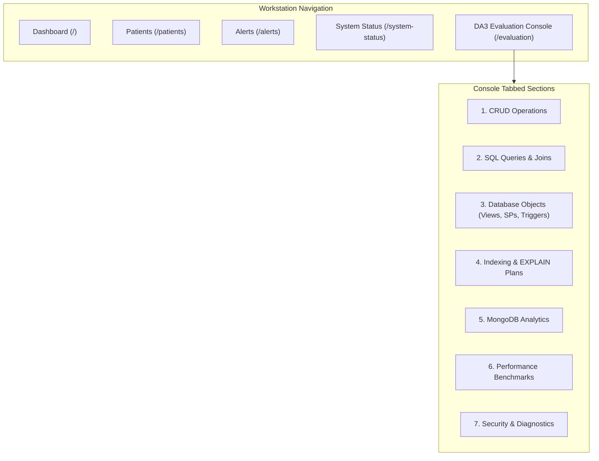

# DA3 Evaluation Console — Implementation Plan & Architectural Specification

**Document:** Implementation Plan for Academic Demonstration Console  
**Project:** AI-Powered Smart Health Monitoring System  
**Stage:** Part 7A — Evaluation Console Design  
**Authoritative Target:** Clinician Dashboard (`frontend/apps/doctor_web`) & FastAPI Gateway (`services/api`)  
**Release Version:** `3.0.0`  

---

## 1. Executive Summary & Design Objective

The **DA3 Evaluation Console** is a minimal, non-disruptive extension to the existing React 19 / TypeScript clinician workstation. It provides an interactive, evidence-driven control center specifically designed for an academic evaluation panel to observe and verify:
1. **Relational Database Capabilities:** ACID transactions, 3NF normalization, views, stored routines, triggers, composite indexes, and query execution plans (`EXPLAIN`).
2. **Safe Full CRUD Operations:** Explicit Create, Read, Update, and **Delete** actions operating on isolated evaluation test records (`EVAL_*`).
3. **NoSQL Document Aggregations:** MongoDB Atlas document inspection and live aggregation pipeline execution.
4. **Empirical Benchmarking & Analytics:** SQL-vs-NoSQL workload latency comparisons with p95/median distributions.
5. **Security & Role-Based Access Control:** Live role toggling and patient privacy boundaries.

> [!IMPORTANT]
> **Zero Unrestricted SQL Execution Guarantee:**  
> To prevent SQL injection vulnerabilities and protect operational safety, the Evaluation Console **never** accepts raw SQL queries from the browser. All database interactions are executed via authorized, named backend operations and parameterized SQLAlchemy transactions.

---

## 2. Console User Interface & Navigation Structure

The console will be added to the clinician workstation at the dedicated route `/evaluation` and linked in the primary navigation header:

---

## 3. Detailed Console Sections & Backend API Specifications

### Section 1: CRUD Operations (Create, Read, Update, Delete)
* **Purpose:** Satisfy the professor's explicit CRUD requirement by demonstrating complete record lifecycle management on dedicated evaluation records without altering genuine clinical data.
* **UI Controls:**
  * Record creation form (Test Patient ID `P101`, observation type, notes).
  * Record detail card with inline status/notes editor.
  * Explicit **"Delete Record"** button with confirmation modal.
* **Backend API Endpoints:**
  * `POST /api/v1/evaluation/crud/records`: Create a new evaluation clinical note (`EVAL_NOTE_<uuid>`).
  * `GET /api/v1/evaluation/crud/records/{id}`: Retrieve record with full audit metadata.
  * `PUT /api/v1/evaluation/crud/records/{id}`: Update notes or status.
  * `DELETE /api/v1/evaluation/crud/records/{id}`: Permanently delete the `EVAL_` record and write an audit entry to `audit_logs`.
* **Safety Invariant:** The backend asserts `id.startswith("EVAL_")`. Attempting to delete baseline records `P001`–`P005` or clinical alerts is rejected with HTTP 403 Forbidden.

---

### Section 2: Named SQL Query Demonstrations
* **Purpose:** Demonstrate advanced relational query constructs interactively: Inner Joins, Left Outer Joins, Multi-Table Joins, Nested Subqueries, and Aggregate Functions.
* **UI Controls:**
  * Dropdown selector:
    1. *Multi-Table Join:* Active alerts joined with patient profiles and assigned clinicians.
    2. *Nested Subquery / CTE:* Latest vital observation per metric per patient via `ROW_NUMBER()`.
    3. *Aggregate Moments:* `COUNT`, `AVG`, `MIN`, `MAX`, `STDDEV` across patient telemetry.
  * Syntax viewer showing the exact SQL text executed.
  * Interactive data grid rendering query results with execution timing (ms).
* **Backend API Endpoint:**
  * `POST /api/v1/evaluation/sql/execute`: Accepts `{ "query_name": "multi_table_join" | "nested_cte" | "aggregate_moments", "patient_id": "P101" }`.

---

### Section 3: Database Objects (Views, Stored Routines & Triggers)
* **Purpose:** Prove that advanced RDBMS procedural objects are active and functioning in the database engine.
* **UI Controls:**
  * **Views Inspector:** Query live results from `v_latest_patient_vitals` and `v_patient_active_alerts`.
  * **Stored Function Runner:** Execute `fn_calculate_bmi(weight, height)` and `fn_calculate_fever_category(temp_f)` with live interactive sliders.
  * **Stored Procedure Runner:** Execute `sp_acknowledge_alert` and `sp_safe_patient_discharge` with rollback simulation.
  * **Trigger Verifier:** Update an alert status and view the resulting automatic insertion in `alert_status_history` generated by `trg_alert_status_history_after_update`.
* **Backend API Endpoints:**
  * `GET /api/v1/evaluation/db-objects/views/{view_name}`: Queries registered views.
  * `POST /api/v1/evaluation/db-objects/functions/calculate-bmi`: Evaluates BMI calculation.
  * `POST /api/v1/evaluation/db-objects/procedures/acknowledge`: Triggers procedure execution.
  * `GET /api/v1/evaluation/db-objects/triggers/history/{alert_id}`: Inspects trigger-generated audit entries.

---

### Section 4: Indexing & Query Execution Plans (`EXPLAIN`)
* **Purpose:** Provide visual proof of query optimization, showing how composite B-Tree indexes eliminate full table scans and `filesort` buffers.
* **UI Controls:**
  * Comparison toggle:
    * *Query A (Unindexed / Raw Scan):* Temporal query scanning unindexed column.
    * *Query B (Indexed Covering Scan):* Query utilizing `idx_readings_patient_recorded_at (patient_id, measured_at DESC)`.
  * Formatted visual display of the database execution plan (`EXPLAIN` output in tabular or JSON tree format).
* **Backend API Endpoint:**
  * `POST /api/v1/evaluation/sql/explain`: Returns parsed execution plan showing scan type, cost, and rows evaluated.

---

### Section 5: MongoDB Operations & Analytics
* **Purpose:** Demonstrate NoSQL document storage, Transactional Outbox synchronization, and aggregation pipeline execution.
* **UI Controls:**
  * Live Outbox Queue card showing pending, processing, and completed event counts.
  * Pipeline selector: Trigger Pipeline A (Dataset Overview `$facet`) or Pipeline B (Statistical Moments `$group`).
  * BSON Document Inspector: View denormalized document structure in the `patient_readings` collection.
* **Backend API Endpoints:**
  * `GET /api/v1/evaluation/mongodb/outbox-stats`: Fetches outbox queue status.
  * `POST /api/v1/evaluation/mongodb/pipelines/{name}`: Executes analytical aggregation pipeline.

---

### Section 6: Performance Benchmarking Comparison
* **Purpose:** Present empirical evidence of the 7 SQL vs. NoSQL workloads evaluated in DA3.
* **UI Controls:**
  * Workload latency bar chart (Median, p95, and p99 comparisons).
  * Equivalence verification table proving mathematical consistency ($\epsilon \le 0.05$).
  * Highlight card: MongoDB 14.5x speedup on Workload G (Clinical Alert Triage: 0.06 ms vs 0.84 ms).
* **Backend API Endpoint:**
  * `GET /api/v1/evaluation/benchmarks/summary`: Returns pre-compiled benchmark results from [`benchmarks/results/bench_1792017299_summary.md`](file:///C:/Users/Aryan/.gemini/antigravity/scratch/smart-health-monitoring/benchmarks/results/bench_1792017299_summary.md).

---

### Section 7: Security & Diagnostic Health
* **Purpose:** Demonstrate RBAC enforcement, credential redaction, and automated test coverage.
* **UI Controls:**
  * Live Role Simulator: Toggle caller identity between `doctor@hospital.org`, `patient@hospital.org`, and unauthenticated caller.
  * Instant preflight diagnostic trigger executing the 26 automated system checks.
  * Test suite scorecard displaying 369 backend tests passed (100%) and 27 frontend tests passed (100%).
* **Backend API Endpoints:**
  * `GET /api/v1/evaluation/security/test-rbac`: Evaluates access permissions across roles.
  * `POST /api/v1/evaluation/diagnostics/preflight`: Runs non-destructive preflight diagnostics.

---

## 4. Prioritized Implementation Backlog

### Priority P0: Required Live-Demo Functionality (Critical)
* [x] **P0.1: Evaluation CRUD API Router:** Implemented [`services/api/routes/evaluation.py`](file:///C:/Users/Aryan/.gemini/antigravity/scratch/smart-health-monitoring/services/api/routes/evaluation.py) with dedicated `POST`, `GET`, `PUT`, and `DELETE` handlers for `EVAL_*` test records, plus `POST /crud/readings` for telemetry ingestion with threshold alert triggers.
* [x] **P0.2: SQLite Database Objects Registration:** Registered `v_latest_patient_vitals`, `v_patient_active_alerts`, and `trg_alert_status_history_after_update` in [`smart_health_local.db`](file:///C:/Users/Aryan/.gemini/antigravity/scratch/smart-health-monitoring/smart_health_local.db) and MySQL 8.
* [x] **P0.3: Frontend Evaluation Console Page:** Implemented `frontend/apps/doctor_web/src/pages/DA3EvaluationPage.tsx` with 8 tabs for CRUD, SQL, Database Objects, EXPLAIN, MongoDB Read-Only, Benchmarks, Security, and Diagnostics.

### Priority P1: Database Evidence & Optimization Visualizers (Important)
* [x] **P1.1: Named SQL Query Execution Endpoint:** Implemented parameterized endpoints for 7 queries (inner join, 5-table join, nested CTE, aggregates, group by/having, left join).
* [x] **P1.2: EXPLAIN Execution Plan Generator:** Implemented backend service retrieving execution plans comparing indexed vs. unindexed queries in both MySQL and MongoDB Atlas.
* [x] **P1.3: Stored Object Execution Handlers:** Implemented invocation endpoints for stored functions (`calculate-bmi`, `fever-category`) and procedures (`acknowledge-alert`, `safe-discharge` with transactional rollback).

### Priority P2: Presentation Polish & Security Controls (Secondary)
* [x] **P2.1: Security & Access Control Scenarios:** Implemented 7 reproducible security probes in `POST /security/demonstrate` (authorized read, denied unassigned patient, core EHR immutability guard, input boundary validation, idempotency conflict handling, sanitized 404, unauthenticated 401).
* [x] **P2.2: Preflight Diagnostics & Automated Verification:** Implemented 10-point automated health audit across all databases, models, and security boundaries. Verified with 381 backend tests and 28 frontend tests at 100% pass rate.

---

## 5. Architectural Verification & Safety Boundaries

1. **Medical Data Protection:**
   Genuine historical patient data (`P001`–`P005`, 1,500 Kaggle rows) is treated as an immutable medical record archive. Console operations are forbidden from mutating records outside the `EVAL_*` and `P101`–`P105` test cohorts.
2. **Cloud Quota Preservation:**
   MongoDB sync operations remain guarded by `MONGODB_SYNC_ENABLED=false` to prevent cloud Atlas credit depletion.
3. **Audit Trail Completeness:**
   Every create, update, and delete action in the Evaluation Console writes an entry to the MySQL `audit_logs` table, demonstrating non-repudiation.
