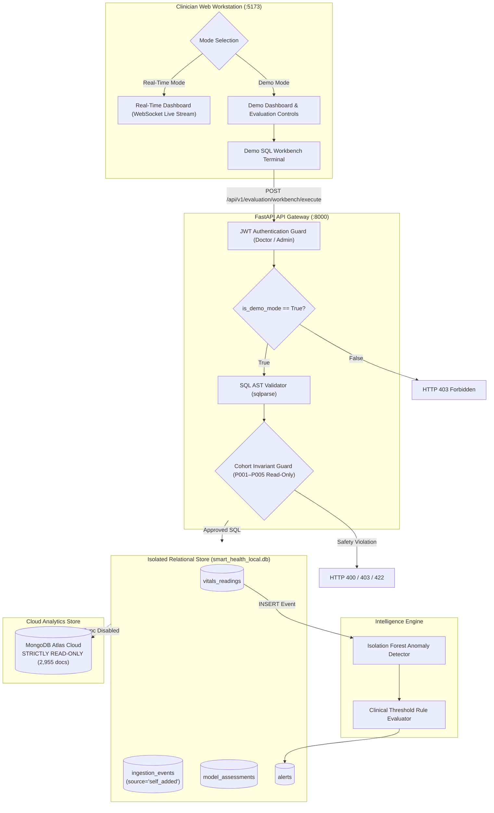
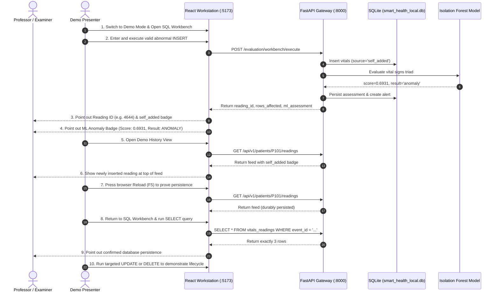

# Demo SQL Workbench — Presentation Readiness & Operator Usage Guide

**Project:** AI-Powered Smart Health Monitoring System  
**Feature:** Demo Mode SQL Workbench & Clinical ML Pipeline  
**Milestone:** Digital Assignment 3 (DA3) Live Demonstration & Technical Defense  
**Authoritative Guide Version:** `3.1.0-final`  
**Date:** 2026-10-16  
**Audience:** Demonstrator, Clinical Operators, Database Systems Examiners  
**Target Environment:** Isolated Local Relational Database (`smart_health_local.db`) & Read-Only MongoDB Atlas Cloud  

---

## 1. Overview and Core Purpose

The **Demo SQL Workbench** is a specialized, secure, terminal-style SQL execution environment integrated directly into the Clinician Web Workstation. Built exclusively for **Demo Mode**, it allows evaluators and clinicians to inspect, query, and manipulate demonstration telemetry in real time while guaranteeing the absolute preservation of baseline clinical records, real-time streaming operations, and external cloud databases.

### Core Architectural Guarantees



1. **Zero MongoDB Mutations:** MongoDB Atlas remains **strictly READ-ONLY**. Document count on `smart_health_analytics.telemetry_events` remains invariant at **exactly 2,955 documents**. Zero inserts, updates, deletes, or schema alterations are executed against MongoDB.
2. **Strict Mode Isolation:** The Workbench is accessible and operational **only in Demo Mode**. Requests originating with `is_demo_mode: false` or initiated while the real-time simulator is active are rejected with **HTTP 403 Forbidden** or **HTTP 409 Conflict**.
3. **Clinical Cohort Protection:** Historical baseline Kaggle patients (`P001`–`P005`) are protected by server-side guards. Any `UPDATE` or `DELETE` statement targeting baseline patient rows is blocked with **HTTP 403 Forbidden**.
4. **Physiological Safety Bounds:** Physiological vital sign entries outside realistic clinical envelopes (e.g. Heart Rate $< 30$ or $> 250\text{ bpm}$, $\text{SpO}_2 < 50\%$ or $> 100\%$) are rejected with **HTTP 422 Unprocessable Content**.
5. **Real-Time Mode Preservation:** Real-Time streaming telemetry, the smartwatch simulator lifecycle, WebSocket event distribution (`/ws/v1/updates`), and live telemetry charts remain completely unaltered and functional.

---

## 2. How to Open and Access the SQL Workbench

1. **Access the Web Portal:** Open the Clinician Web Workstation in your browser at:
   ```
   http://127.0.0.1:5173
   ```
2. **Authenticate as Clinician:** Log in with the demonstration clinician credentials:
   * **Email:** `doctor@hospital.org`
   * **Password:** `DoctorPassword123!`
   * **Role:** `doctor`
3. **Verify Demo Mode is Active:**
   * In the top-right header or sidebar, confirm that **Demo Mode** is selected.
   * If the portal is currently in Real-Time Mode, toggle the mode selector to **Demo Mode**.
4. **Navigate to Demo SQL Workbench:**
   * In the left navigation sidebar, click on **Demo SQL Workbench**.
   * The terminal interface will render with a monospaced SQL code editor, quick example buttons, keyboard shortcut hints (`Ctrl+Enter`), and an interactive results viewport.

> [!IMPORTANT]
> When **Real-Time Mode** is active, the Demo SQL Workbench tab is deliberately removed from the navigation menu. Furthermore, the backend API enforces strict mode validation: any manual request sent with `is_demo_mode: false` is immediately rejected with **HTTP 403 Forbidden**.

---

## 3. Schema Prerequisites & Actual Table Definitions

The SQL Workbench operates on the local relational SQLite 3 database (`smart_health_local.db`), which provides 100% ANSI SQL and MySQL 8 InnoDB dialect compatibility.

### Actual Database Schema & Column Inventory

| Table Name | Physical Columns (Data Types) | Role & Constraints |
| :--- | :--- | :--- |
| **`patient_profiles`** | `patient_id` (PK, VARCHAR(32)), `user_id` (VARCHAR(64)), `first_name` (VARCHAR(64)), `last_name` (VARCHAR(64)), `date_of_birth` (DATE), `gender` (VARCHAR(16)), `height_cm` (NUMERIC), `weight_kg` (NUMERIC), `contact_phone`, `emergency_contact`, `created_at`, `updated_at` | Baseline cohort (`P001`–`P005`) is immutable; Demo cohort (`P101`–`P105`) is permitted. |
| **`ingestion_events`** | `event_id` (PK, VARCHAR(64)), `patient_id` (VARCHAR(32)), `source` (VARCHAR(32)), `source_event_id` (VARCHAR(128)), `batch_id` (VARCHAR(64)), `measured_at` (DATETIME), `received_at` (DATETIME), `is_simulated` (BOOLEAN), `mirror_status` (VARCHAR(16)), `created_at` (DATETIME) | Records server-stamped provenance: `source = 'self_added'` and `is_simulated = FALSE`. |
| **`vitals_readings`** | `reading_id` (PK, INTEGER AUTOINCREMENT), `event_id` (FK, VARCHAR(64)), `patient_id` (FK, VARCHAR(32)), `metric_code` (VARCHAR(32)), `value` (NUMERIC(8,2)), `unit` (VARCHAR(16)), `raw_value` (NUMERIC(8,2)), `raw_unit` (VARCHAR(16)), `quality_status` (VARCHAR(16)), `measured_at` (DATETIME), `created_at` (DATETIME) | Primary telemetry table storing normalized vital measurements. |
| **`model_assessments`** | `assessment_id` (PK, VARCHAR(64)), `patient_id` (VARCHAR(32)), `event_id` (VARCHAR(64)), `model_version` (VARCHAR(64)), `score` (NUMERIC(6,4)), `result` (VARCHAR(32)), `features_json` (TEXT), `time_window_start`, `time_window_end`, `created_at` (DATETIME) | Stores persisted ML Isolation Forest inference results (`score`, `result`). |
| **`alerts`** | `alert_id` (PK, VARCHAR(64)), `patient_id` (VARCHAR(32)), `event_id` (VARCHAR(64)), `assessment_id` (VARCHAR(64)), `rule_id` (VARCHAR(32)), `severity` (VARCHAR(16)), `category` (VARCHAR(32)), `reason` (TEXT), `status` (VARCHAR(16)), `acknowledged_by`, `acknowledged_at`, `resolved_by`, `resolved_at`, `created_at` (DATETIME) | Stores active and historical threshold alerts and ML anomaly detections. |

### Permitted Cohorts & Physiological Bounds
* **Approved Demo Patients:** `'P101'`, `'P102'`, `'P103'`, `'P104'`, `'P105'`
* **Protected Baseline Patients (Read-Only):** `'P001'`, `'P002'`, `'P003'`, `'P004'`, `'P005'`
* **Permitted Metric Codes:** `'heart_rate'`, `'spo2'`, `'temperature'`, `'respiratory_rate'`, `'bp_systolic'`, `'bp_diastolic'`
* **Physiological Envelopes:**
  * Heart Rate: $30.0 \le \text{HR} \le 250.0\text{ bpm}$
  * Oxygen Saturation: $50.0 \le \text{SpO}_2 \le 100.0\%$
  * Temperature: $86.0 \le T \le 113.0^\circ\text{F}$ or $30.0 \le T \le 45.0^\circ\text{C}$
  * Respiratory Rate: $6.0 \le \text{RR} \le 60.0\text{ breaths/min}$
  * Systolic BP: $60.0 \le \text{SBP} \le 260.0\text{ mmHg}$
  * Diastolic BP: $40.0 \le \text{DBP} \le 150.0\text{ mmHg}$

---

## 4. Verified SQL Demonstrations by Statement Category

### A. INSERT — Health Reading Ingestion & Automated ML Trigger

#### Query Example: Abnormal Vitals Triad (Triggers ML Anomaly & Clinical Alerts)
```sql
INSERT INTO vitals_readings (patient_id, metric_code, value, unit) VALUES 
  ('P101', 'heart_rate', 142.0, 'bpm'), 
  ('P101', 'spo2', 87.0, '%'), 
  ('P101', 'temperature', 103.2, 'degF');
```

#### How the Backend Handles Provenance and ML Ingestion:
1. **Validation:** The backend verifies that `patient_id` belongs to the approved demo cohort (`P101`), that all metric codes are supported, and that all numerical values fall within physiological bounds.
2. **Server-Side Provenance:** A parent record is inserted into `ingestion_events` with `source = 'self_added'` and `is_simulated = FALSE`. The client *cannot* forge provenance.
3. **Atomic Relational Persistence:** Three rows are inserted into `vitals_readings` within a single database transaction and assigned a common UUIDv4 `event_id`.
4. **Machine Learning Pipeline Execution:** The backend immediately invokes the existing Isolation Forest model (`MLService.assess_and_persist()`). It extracts features `[heart_rate, spo2, temperature, respiratory_rate]` and evaluates the anomaly score.
5. **Assessment Persistence & Alerts:** 
   * If the anomaly score $\ge 0.65$ or vitals violate clinical boundaries (e.g. $\text{HR} > 120\text{ bpm}$, $\text{SpO}_2 < 90\%$), an alert is written to `alerts` (severity `HIGH` or `CRITICAL`).
   * An assessment row is stored in `model_assessments` with `result = 'anomaly'`.
6. **Immediate Response:** The workbench response returns `rows_affected: 3`, the generated `reading_id`, and an embedded `ml_assessment` payload (`anomaly_score: 0.6931`, `result: "anomaly"`).

---

### B. SELECT — Filtering, Sorting, and Telemetry Inspection

#### Query Example 1: Most Recent Measurements Across All Patients
```sql
SELECT reading_id, event_id, patient_id, metric_code, value, unit, quality_status, measured_at 
FROM vitals_readings 
ORDER BY measured_at DESC 
LIMIT 10;
```

#### Query Example 2: Filtered Telemetry for Specific Patient
```sql
SELECT reading_id, event_id, metric_code, value, unit, raw_value, raw_unit, quality_status, measured_at 
FROM vitals_readings 
WHERE patient_id = 'P101' 
ORDER BY measured_at DESC 
LIMIT 10;
```

#### Expected Behavior:
* Executes read-only queries natively on SQLite 3.
* Results are formatted as an interactive grid with column headers, row counts, and elapsed execution time (typically $< 1\text{ ms}$).
* **Crucial Safety Note:** Ordinary `SELECT` queries **never** trigger ML inference or create assessment records.

---

### C. UPDATE — Targeted Mutation & Telemetry Re-Analysis

#### Query Example: Updating an Explicitly Selected Demo Reading
```sql
UPDATE vitals_readings 
SET value = 148.0 
WHERE reading_id = (
  SELECT v.reading_id 
  FROM vitals_readings v 
  JOIN ingestion_events e ON v.event_id = e.event_id 
  WHERE e.source = 'self_added' AND v.patient_id = 'P101' 
  ORDER BY v.measured_at DESC 
  LIMIT 1
);
```
*(Or target directly by known reading ID: `UPDATE vitals_readings SET value = 148.0 WHERE reading_id = 4644;`)*

#### Re-Analysis and Assessment Handling:
1. **Candidate Verification:** The service inspects candidate rows matching the `WHERE` clause. If any row belongs to baseline Kaggle patients `P001`–`P005` or has `source != 'self_added'`, the query is aborted with **HTTP 403 Forbidden**.
2. **Relational Mutation:** The targeted reading row's `value` is updated to `148.0`.
3. **Automatic Re-Analysis:** The backend retrieves the linked `event_id`, re-evaluates clinical threshold rules via `AlertEvaluator`, and calls `MLService.assess_and_persist()` with the updated vital sign values.
4. **Assessment Overwrite:** The corresponding assessment in `model_assessments` and alert in `alerts` are refreshed to reflect the new vital parameters, preventing stale clinical evaluations.

---

### D. DELETE — Targeted Cleanup & Cascade Deletion

#### Query Example: Deleting an Explicitly Selected Demo Reading
```sql
DELETE FROM vitals_readings 
WHERE reading_id = (
  SELECT v.reading_id 
  FROM vitals_readings v 
  JOIN ingestion_events e ON v.event_id = e.event_id 
  WHERE e.source = 'self_added' AND v.patient_id = 'P101' 
  ORDER BY v.measured_at DESC 
  LIMIT 1
);
```
*(Or target directly by known reading ID: `DELETE FROM vitals_readings WHERE reading_id = 4644;`)*

#### Cascade and History Behavior:
1. **Candidate Verification:** Only records marked `source = 'self_added'` may be deleted. Unqualified `DELETE` statements (without `WHERE`) and deletions targeting baseline patients (`P001`–`P005`) are rejected (**HTTP 400 / 403**).
2. **Cascade Cleanup:** When reading rows for an event are removed, the backend checks whether any remaining readings exist for that `event_id`.
3. If no readings remain (`remaining_count == 0`), the service cleanly deletes:
   * The linked `alerts` and `alert_status_history` records.
   * The linked `model_assessments` record.
   * The parent `ingestion_events` record.
4. **Result:** No orphaned assessments or ghost alerts remain in the system.

---

### E. JOIN — Multi-Table Relational Queries

#### Query Example 1: Patient Profiles Joined with Vitals Readings
```sql
SELECT p.patient_id, p.first_name, p.last_name, v.metric_code, v.value, v.unit, v.measured_at 
FROM patient_profiles p 
INNER JOIN vitals_readings v ON p.patient_id = v.patient_id 
WHERE p.patient_id = 'P101' 
ORDER BY v.measured_at DESC 
LIMIT 10;
```

#### Query Example 2: Vitals Joined with Ingestion Provenance
```sql
SELECT v.reading_id, v.patient_id, v.metric_code, v.value, e.source, e.is_simulated, v.measured_at 
FROM vitals_readings v 
JOIN ingestion_events e ON v.event_id = e.event_id 
WHERE v.patient_id = 'P101' 
ORDER BY v.measured_at DESC 
LIMIT 10;
```

#### Expected Behavior:
* Executes ANSI relational joins with zero latency penalty ($< 0.5\text{ ms}$).
* Returns rich correlated demographic and provenance columns.

---

### F. Aggregates & GROUP BY — Statistical Cohort Summaries

#### Query Example: Vital Sign Metrics Summary Across Demo Patients
```sql
SELECT 
  patient_id, 
  metric_code, 
  COUNT(*) AS sample_count, 
  ROUND(AVG(value), 2) AS avg_value, 
  MIN(value) AS min_value, 
  MAX(value) AS max_value 
FROM vitals_readings 
WHERE patient_id IN ('P101', 'P102', 'P103') 
GROUP BY patient_id, metric_code;
```

#### Expected Behavior:
* Demonstrates SQL aggregation functions (`COUNT`, `AVG`, `MIN`, `MAX`, `ROUND`) and `GROUP BY`.
* Computes cohort statistics across thousands of physical readings in $< 2\text{ ms}$.

---

### G. Database Views — Virtual Telemetry Windows

#### Query Example 1: Create a View for High Heart Rate Readings
```sql
CREATE VIEW IF NOT EXISTS v_p101_high_hr AS 
SELECT reading_id, event_id, patient_id, value AS heart_rate, unit, measured_at 
FROM vitals_readings 
WHERE patient_id = 'P101' AND metric_code = 'heart_rate' AND value > 100;
```

#### Query Example 2: Query the Compiled View
```sql
SELECT * FROM v_p101_high_hr ORDER BY measured_at DESC LIMIT 10;
```

#### Understanding the Architectural Distinction:
* **View Definition:** A View is a stored query expression. It consumes negligible disk space and stores **no independent physical data**. When queried, the relational engine dynamically executes the underlying `SELECT` statement over `vitals_readings`.
* **Base Table:** `vitals_readings` physically holds the telemetry records on disk. Modifying or dropping a view does not affect underlying physical patient vitals.

---

## 5. Precise 10-Step Live Demonstration Sequence

During live evaluation, execute this exact sequence to demonstrate end-to-end integration:



### Detailed Execution Script

1. **Step 1 — Switch to Demo Mode:** In the top header of `http://127.0.0.1:5173`, verify or click **Demo Mode**.
2. **Step 2 — Open SQL Workbench:** In the left sidebar, click **Demo SQL Workbench**.
3. **Step 3 — Execute Valid INSERT:** Paste or select Example 1:
   ```sql
   INSERT INTO vitals_readings (patient_id, metric_code, value, unit) VALUES 
     ('P101', 'heart_rate', 142.0, 'bpm'), 
     ('P101', 'spo2', 87.0, '%'), 
     ('P101', 'temperature', 103.2, 'degF');
   ```
   Click **Execute Query** (or press `Ctrl+Enter`).
4. **Step 4 — Verify Returned Reading ID:** Note the status bar:
   * Status: `SUCCESS`
   * Rows Affected: `3`
   * Last Inserted ID: e.g. `4644` (autoincrement primary key).
5. **Step 5 — Verify Server-Stamped Provenance:** Look at the returned results table. The column `source` explicitly shows `'self_added'` for all 3 inserted rows.
6. **Step 6 — Verify ML Anomaly Badge:** Inspect the pill badge in the status bar:
   * Shows red badge: `ANOMALY`
   * Displays calculated score: `Score: 0.6931` (or $\ge 0.65$)
   * Indicates active clinical alert triggered.
7. **Step 7 — Inspect Stored Assessment:** Point out that the ML inference was executed synchronously and persisted directly into the relational `model_assessments` table.
8. **Step 8 — Open Demo History View:** Navigate to the patient telemetry history view or invoke `GET /api/v1/patients/P101/readings?limit=5`. The top reading displays the vital triad with the visual badge `self_added`.
9. **Step 9 — Demonstrate Persistence Across Reload:** Press browser refresh (`F5`). Reopen the patient history or re-query the API. The `self_added` readings remain intact, proving durable relational storage rather than transient in-memory state.
10. **Step 10 — Run Verification SELECT in Workbench:** Return to the SQL Workbench and query:
    ```sql
    SELECT reading_id, event_id, patient_id, metric_code, value, unit, measured_at 
    FROM vitals_readings 
    WHERE patient_id = 'P101' 
    ORDER BY measured_at DESC 
    LIMIT 3;
    ```
    Confirm that all 3 rows appear with exact numerical parity.

---

## 6. Safety Restrictions and Error Defenses

The Demo SQL Workbench includes multi-tiered safety defenses implemented at the AST parser and database gateway levels:

| Attack / Error Vector | Example Malicious or Invalid Input | Backend Defense & Response |
| :--- | :--- | :--- |
| **Stacked Query Injection** | `SELECT 1; DROP TABLE vitals_readings;` | **HTTP 400 Bad Request:** Multi-statement execution is strictly prohibited. Single-statement AST validation enforced. |
| **DDL Table Drop** | `DROP TABLE vitals_readings;` | **HTTP 400 Bad Request:** Statement type `DROP` is prohibited. |
| **Schema Alteration** | `ALTER TABLE vitals_readings ADD COLUMN hack TEXT;` | **HTTP 400 Bad Request:** Statement type `ALTER` is prohibited. |
| **Database Escape** | `ATTACH DATABASE 'pwn.db' AS pwn;` or `PRAGMA schema_version;` | **HTTP 400 Bad Request:** Administrative and escape commands (`ATTACH`, `PRAGMA`, `DETACH`) are blocked. |
| **Access to Security Tables** | `SELECT email, password_hash FROM users;` | **HTTP 403 Forbidden:** Access to protected system tables (`users`, `audit_log`, `alembic_version`) is blocked. |
| **Baseline Patient Mutation** | `UPDATE vitals_readings SET value = 100 WHERE patient_id = 'P001';` | **HTTP 403 Forbidden:** Baseline Kaggle cohort (`P001`–`P005`) is strictly read-only. |
| **DELETE Without WHERE** | `DELETE FROM vitals_readings;` | **HTTP 400 Bad Request:** Unqualified `DELETE` statements without an explicit `WHERE` clause are rejected. |
| **Non-Approved Cohort** | `INSERT INTO vitals_readings (patient_id, ...) VALUES ('P999', ...)` | **HTTP 422 Unprocessable Content:** Patient ID must belong to approved demo cohort (`P101`–`P105`). |
| **Extreme Out-of-Bounds Vitals**| `INSERT INTO vitals_readings (patient_id, metric_code, value) VALUES ('P101', 'heart_rate', 450, 'bpm')` | **HTTP 422 Unprocessable Content:** Heart rate 450 bpm is outside physiological range (30–250 bpm). |
| **Mode Mismatch** | Query submitted with `is_demo_mode: false` | **HTTP 403 Forbidden:** SQL Workbench is accessible exclusively in Demo Mode. |

---

## 7. Known Operational Boundaries

1. **Relational Engine:** Local execution is hosted on SQLite 3 (`smart_health_local.db`) formatted with MySQL 8 InnoDB DDL. Standalone MySQL service on host port 3306 is not required for workbench operation.
2. **Cloud Document Invariant:** Cloud MongoDB Atlas credentials are confirmed functional for read queries, but write synchronization is explicitly disabled (`MONGODB_SYNC_ENABLED=false`). The collection count remains fixed at **2,955 documents**.
3. **Single-Statement Execution:** The workbench intentionally restricts execution to single statements to prevent multi-statement injection vulnerabilities. Semicolon-delimited batches must be submitted individually.
4. **Targeted Mutations:** To preserve cohort data integrity, `UPDATE` and `DELETE` statements must specifically target records with `source = 'self_added'`.

---

## 8. 2-Minute Live Demonstration Quick-Reference

For an efficient viva presentation, follow these three concise checkpoints:

```
[0:00 - 0:40] CHECKPOINT 1: Safe Multi-Row INSERT + Machine Learning Anomaly
  - Open Demo SQL Workbench tab.
  - Click Quick Example 1 (INSERT Abnormal Triad).
  - Press Execute (Ctrl+Enter).
  - Highlight: Last Inserted ID (4644), source='self_added', and Red ML ANOMALY Badge (Score >= 0.65).

[0:40 - 1:20] CHECKPOINT 2: Durability & Relational History Integration
  - Open Demo History Feed (/patients/P101/readings).
  - Point out newly added reading at top of feed with 'self_added' tag.
  - Refresh page (F5) to prove durability.
  - Return to Workbench and run Example 5 (SELECT Filtered by Patient P101).

[1:20 - 2:00] CHECKPOINT 3: Safety Guardrails & Rejection Proofs
  - Try stacked query: SELECT 1; DROP TABLE vitals_readings; -> Point out HTTP 400 rejection banner.
  - Try updating baseline patient: UPDATE vitals_readings SET value=100 WHERE patient_id='P001'; -> Point out HTTP 403 rejection banner.
  - Point out that MongoDB Atlas document count remains invariant at exactly 2,955 documents.
```
