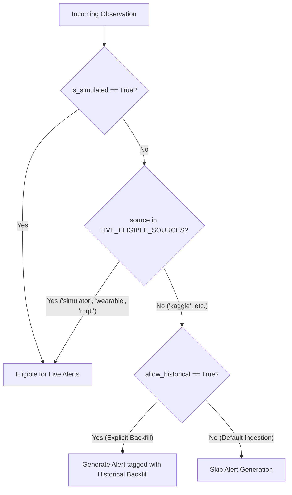
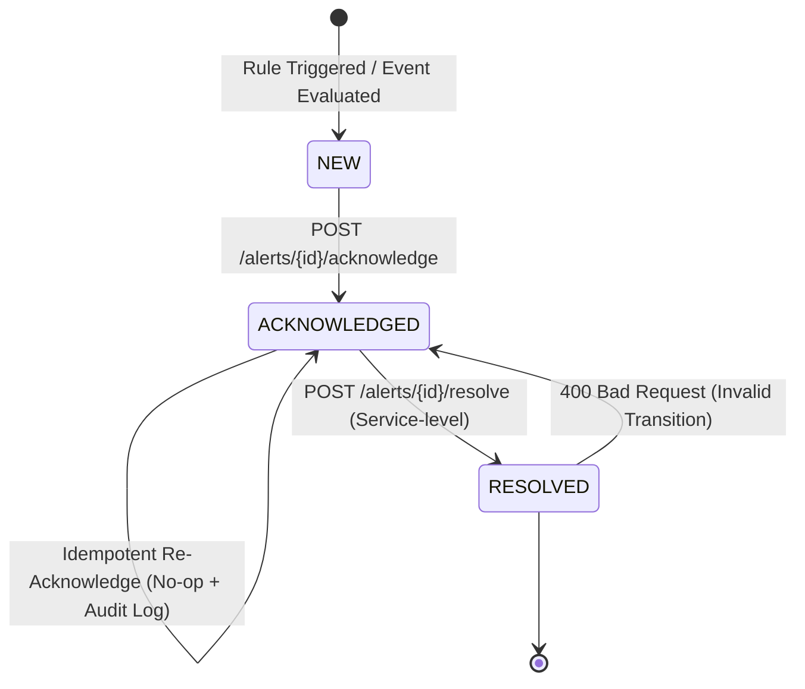

# Health Alert Lifecycle, Clinical Threshold Rules, and Audit Trail Architecture

> [!CAUTION]
> **PROVISIONAL DEMONSTRATION RULES — NOT FOR MEDICAL USE OR CLINICAL DIAGNOSIS**  
> All thresholds, rules, severities, and alert generation logic documented herein are designed solely for software engineering verification, testing, and simulated telemetry pipelines. These rules do NOT represent validated clinical decision support and must never be used for real-world patient triage, diagnostics, or treatment.

---

## 1. Executive Overview

The Smart Health Monitoring System implements a deterministic, rule-based clinical alert evaluation engine designed for healthcare telemetry streams. The alert subsystem bridges incoming sensor measurements with clinical staff workflows through:

1. **Configurable Threshold Rules**: Type-safe, unit-validated evaluations against physiological vital signs (heart rate, SpO2, body temperature).
2. **Strict Provenance Filtering**: Delineation between live telemetry/simulators and historical batch imports (e.g. Kaggle datasets).
3. **Idempotent Ingestion & Storage**: Elimination of duplicate alerts for identical triggering events and rules via deterministic identifiers and unique constraints.
4. **State Machine Lifecycle Management**: Explicit status transitions (`NEW` $\to$ `ACKNOWLEDGED` $\to$ `RESOLVED`) tracked in immutable history trails.
5. **Server-Side Authorization**: Enforced patient privacy where patients view only their own records and clinicians access only assigned patients.
6. **Zero-Secret Audit Logging**: Immutable security logs capturing all alert generations, status transitions, and repeated acknowledgement attempts.

---

## 2. Standard Demonstration Rules Catalog

The catalog defines deterministic threshold rules across core vital sign metrics. Each rule enforces strict unit matching and quality validation (`quality_status == 'valid'`).

| Rule ID | Metric | Operator | Threshold Value | Unit | Severity | Clinical Rationale (Demonstration Only) |
| :--- | :--- | :---: | :---: | :---: | :---: | :--- |
| `RULE_HR_HIGH` | `heart_rate` | `>` | 100.00 | `bpm` | `HIGH` | Heart rate exceeds 100 bpm (demonstration threshold for tachycardia). |
| `RULE_HR_CRITICAL_HIGH` | `heart_rate` | `>` | 130.00 | `bpm` | `CRITICAL` | Heart rate exceeds 130 bpm (severe tachycardia). |
| `RULE_HR_LOW` | `heart_rate` | `<` | 50.00 | `bpm` | `MEDIUM` | Heart rate drops below 50 bpm (demonstration threshold for bradycardia). |
| `RULE_SPO2_LOW` | `spo2` | `<` | 90.00 | `%` | `HIGH` | Blood oxygen saturation drops below 90% (demonstration threshold for hypoxemia). |
| `RULE_SPO2_CRITICAL_LOW` | `spo2` | `<` | 85.00 | `%` | `CRITICAL` | Blood oxygen saturation drops below 85% (severe hypoxemia). |
| `RULE_TEMP_HIGH` | `temperature` | `>` | 38.00 | `degC` | `MEDIUM` | Core temperature exceeds 38.0°C / 100.4°F (fever). |
| `RULE_TEMP_CRITICAL_HIGH` | `temperature` | `>` | 39.50 | `degC` | `CRITICAL` | Core temperature exceeds 39.5°C / 103.1°F (high fever). |
| `RULE_TEMP_LOW` | `temperature` | `<` | 35.00 | `degC` | `HIGH` | Core temperature drops below 35.0°C / 95.0°F (hypothermia). |

### Quality & Unit Guardrails
- **Measurement Quality Guard**: If `reading.quality_status != 'valid'`, the reading is rejected by all rules. Stale, out-of-range, or suspect readings never generate clinical alerts.
- **Unit Matching Guard**: If `reading.unit != rule.unit`, the rule evaluation immediately returns `False`. The engine never evaluates a Celsius threshold against a Fahrenheit reading.
- **Missing Value Guard**: `None` values are never coerced to zero.

---

## 3. Telemetry Provenance and Source Eligibility

To prevent batch CSV imports (such as historical Kaggle benchmarks) from flooding the system with synthetic medical emergencies, the engine enforces strict source eligibility policies:



- **Live & Simulated Sources**: Observations from `simulator`, `wearable`, `live_stream`, or `mqtt_telemetry` (or any event where `is_simulated=True`) are immediately evaluated.
- **Historical Ingestion**: Historical Kaggle rows (`source='kaggle'`, `is_simulated=False`) are suppressed from alert evaluation during normal ingestion. During an explicit backfill run (`allow_historical=True`), generated alerts are tagged with `[Historical Backfill — Non-Live Record]`.

---

## 4. Deterministic Alert IDs and Idempotency Guarantees

Clinical systems must remain idempotent under network retries, streaming replays, and concurrent workers.

### Deterministic Identifier
Alert IDs are generated using a deterministic SHA-256 hash of the triggering event identifier and rule identifier:

$$\text{alert\_id} = \text{"alt\_"} + \text{SHA256}(\text{event\_id} + ":" + \text{rule\_id})[:24]$$

### Database Uniqueness
The MySQL and SQLite schemas enforce an authoritative uniqueness constraint:
```sql
CONSTRAINT uq_alerts_event_rule UNIQUE (event_id, rule_id)
```

### Savepoint-Protected Insert
In `AlertRepository.create_or_get_alert`:
1. The repository first queries by `(event_id, rule_id)` and `alert_id`.
2. If absent, an insert is attempted inside a nested transactional savepoint (`with session.begin_nested():`).
3. If a race condition occurs, the `IntegrityError` is intercepted, rolled back to the savepoint without invalidating the parent transaction, and the existing persisted record is returned with `was_created=False`.

---

## 5. Alert Lifecycle and State Machine



1. **`NEW`**: Created automatically upon rule threshold breach. `acknowledged_by` and `resolved_by` are `NULL`.
2. **`ACKNOWLEDGED`**: Clinical staff has reviewed the alert. `acknowledged_by` is stamped with the authenticated user ID and `acknowledged_at` with the server UTC timestamp.
   - **Idempotency**: Calling acknowledge on an already acknowledged alert succeeds with `200 OK`, leaving the original timestamp and actor intact, and logging an `ALERT_ACKNOWLEDGE_REPEATED` audit record.
3. **`RESOLVED`**: The underlying condition has cleared or clinical intervention completed.
   - Attempting to acknowledge a resolved alert raises an `InvalidStateTransitionError` (`400 Bad Request`).

---

## 6. Server-Side Authorization Matrix

The backend enforces all authorization boundaries. The client is never trusted to self-regulate access.

| Role | Patient's Own Alerts | Assigned Patient's Alerts | Unassigned Patient's Alerts |
| :--- | :---: | :---: | :---: |
| **Patient** | Allowed (`200 OK`) | N/A | Forbidden (`403 Forbidden`) |
| **Clinician (Doctor / Nurse)** | Allowed if assigned | Allowed (`200 OK`) | Forbidden (`403 Forbidden`) |
| **Admin Operator** | Allowed (`200 OK`) | Allowed (`200 OK`) | Allowed (`200 OK`) |

---

## 7. REST API Endpoints Reference

### 1. `GET /patients/{patient_id}/alerts`
- **Description**: Returns paginated alerts for a patient, ordered by `created_at DESC` with `alert_id DESC` tie-breaking.
- **Query Parameters**:
  - `status`: Optional filter (`NEW`, `ACKNOWLEDGED`, `RESOLVED`).
  - `severity`: Optional filter (`LOW`, `MEDIUM`, `HIGH`, `CRITICAL`).
  - `start_time`: Inclusive UTC start datetime filter.
  - `end_time`: Inclusive UTC end datetime filter.
  - `page`: 1-indexed page number (default: 1).
  - `page_size`: Bounded limit between 1 and 100 (default: 20).
- **Responses**:
  - `200 OK`: `PaginatedAlertsResponse` with `items`, `total_count`, `page`, `page_size`, `total_pages`, `has_next`, `has_previous`.
  - `400 Bad Request`: Invalid filter parameter or time range inversion.
  - `403 Forbidden`: Authenticated user lacks access to target patient.

### 2. `GET /alerts/{alert_id}`
- **Description**: Returns full details for a single alert.
- **Responses**:
  - `200 OK`: `AlertResponse` model.
  - `403 Forbidden`: Authenticated user not assigned to the alert's patient.
  - `404 Not Found`: Alert does not exist.

### 3. `POST /alerts/{alert_id}/acknowledge`
- **Description**: Acknowledges an open alert.
- **Request Body** (optional):
  ```json
  {
    "note": "Verified vital signs; medication administered."
  }
  ```
- **Responses**:
  - `200 OK`: Updated `AlertResponse` with `status: "ACKNOWLEDGED"`.
  - `400 Bad Request`: Attempting to acknowledge a resolved alert.
  - `403 Forbidden`: User unauthorized to manage patient's alerts.
  - `404 Not Found`: Alert does not exist.

---

## 8. Compliance & Security Audit Trail

All alert-related security actions are appended to the immutable `audit_logs` table:

1. **`ALERT_TRIGGERED`**: Logged whenever a new alert is generated. Captures patient ID, rule ID, metric, value, unit, and severity.
2. **`ALERT_ACKNOWLEDGE`**: Logged on first successful state transition to `ACKNOWLEDGED`. Captures actor ID and previous status.
3. **`ALERT_ACKNOWLEDGE_REPEATED`**: Logged on idempotent repeated acknowledgements to monitor duplicate actions without failing client retries.
4. **`ALERT_RESOLVE`**: Logged when an alert is resolved.

> [!NOTE]
> Audit logs store only IDs, action names, timestamps, and structured JSON metadata. Passwords, JWT secrets, bearer tokens, and raw unverified payloads are strictly barred from the audit log repository.
