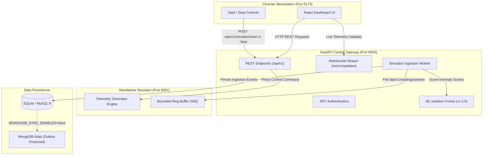

# Live Demonstration Launcher & Preflight Guide

**System:** AI-Powered Smart Health Monitoring System  
**Stage:** Part 6M — Demo Launcher, Orchestration, and System Verification  
**Audience:** Demonstrators, Faculty Examiners, and DevOps Engineers  

---

## 1. Architecture & Port Map

The Smart Health Monitoring System uses a microservice architecture coordinated by the central FastAPI Gateway:

| Component | Technology | Default Port | Working Directory | Purpose |
|:---|:---|:---:|:---|:---|
| **Smartwatch Simulator** | FastAPI / Python | `8001` | Repository Root | Synthetic physiological telemetry generator for demo cohort (`P101`–`P105`). Starts in **STOPPED** state by default. |
| **FastAPI Backend Gateway** | FastAPI / Python | `8000` | Repository Root | Primary REST API, JWT auth, background ingestion worker, ML inference, SQLite/MySQL persistence, WebSockets. |
| **Clinician React Portal** | Vite / React 19 / TS | `5173` | `frontend/apps/doctor_web` | Clinician workstation for patient roster, live telemetry sparklines, simulator Start/Stop controls, alerts, and messaging. |
| **Streamlit Analytics** | Streamlit / Python | `8501` | Repository Root | *Optional*: DA3 SQL-vs-NoSQL performance benchmarks and population distribution visualizer. |



---

## 2. Prerequisites & Environment Setup

### 2.1 Required Runtimes
- **Python:** Version `3.10` or higher (`python --version`)
- **Node.js:** Version `18.0` or higher (`node --version`)
- **npm / npx:** Version `9.0` or higher (`npm --version`)
- **PowerShell:** Version `5.1` or higher on Windows (or standard Bash on Linux/macOS)

### 2.2 Environment Configuration (`.env`)
Ensure `.env` exists in the project root. Key demonstration settings:

```ini
APP_NAME="Smart Health Monitoring System"
APP_ENV=development
API_HOST=127.0.0.1
API_PORT=8000
DATABASE_URL=sqlite:///./smart_health_local.db

# Master switch: strictly prevents quota exhaustion during live demonstrations
MONGODB_SYNC_ENABLED=false

# Smartwatch simulator configuration
SENSOR_SIMULATOR_BASE_URL=http://127.0.0.1:8001
SIMULATOR_INGESTION_ENABLED=true
SIMULATOR_POLL_INTERVAL_SECONDS=5.0

# Security (JWT secret must be >= 32 characters)
JWT_SECRET=local_development_secret_key_at_least_32_bytes_long!
```

> [!IMPORTANT]
> Keep `MONGODB_SYNC_ENABLED=false` at all times during local presentations. This guarantees zero unauthorized writes to MongoDB Atlas, preventing cluster storage quota exhaustion.

---

## 3. One-Command Live Demonstration Launcher

### 3.1 Primary Launcher (PowerShell on Windows)
Run from the repository root:

```powershell
powershell -ExecutionPolicy Bypass -File scripts\launch_demo.ps1
```

### 3.2 Cross-Platform Python Launcher (Windows, macOS, Linux)
```bash
python scripts/launch_demo.py
```

### 3.3 Available Launcher Flags
| Flag | Description |
|:---|:---|
| `-PreflightOnly` / `--preflight-only` | Executes full 26-point diagnostic suite without starting background processes. |
| `-NoBrowser` / `--no-browser` | Suppresses automatic browser launch (useful for automated testing or headless environments). |
| `-NoStreamlit` / `--no-streamlit` | Skips starting the optional Streamlit analytics dashboard. |
| `-ForceRestart` | Safely terminates any existing demo services before starting fresh instances. |
| `-HealthTimeoutSeconds 30` | Configures custom maximum wait time for slow hardware (default: 25 seconds). |

---

## 4. Preflight Diagnostics & Verification

Before presenting to examiners or clients, execute the preflight diagnostic tool to verify all 26 checkpoints:

```bash
# Full dynamic check (verifies running services, DB, ML, WebSockets, Auth)
python scripts/preflight_check.py

# Offline check (verifies files, runtimes, database schema, ML artifacts only)
python scripts/preflight_check.py --offline
```

### 4.1 Status Categories & Meaning
- `PASS` (Green): Verified operational according to system requirements.
- `WARN` (Yellow): Non-blocking limitation (e.g. optional Streamlit visualizer offline, or MongoDB Atlas sync disabled). Does **not** prevent demonstration.
- `FAIL` (Red): Required core dependency broken (e.g. backend offline, missing `.env`, database unreadable). Must be resolved prior to demo.
- `NOT CHECKED` (Gray): Dependent check skipped because prerequisite service was offline.

---

## 5. Demonstration URLs & Credentials

Once launched, open the following endpoints:

| Application | URL | Authentication Credentials | Notes |
|:---|:---|:---|:---|
| **Clinician Portal** | [http://127.0.0.1:5173](http://127.0.0.1:5173) | `doctor@hospital.org` / `DoctorPassword123!` | Primary presenter view |
| **FastAPI Swagger Docs** | [http://127.0.0.1:8000/docs](http://127.0.0.1:8000/docs) | None required | Interactive API exploration |
| **Simulator API Docs** | [http://127.0.0.1:8001/docs](http://127.0.0.1:8001/docs) | None required | Simulator microservice routes |
| **Streamlit Analytics** | [http://localhost:8501](http://localhost:8501) | None required | DA3 benchmark graphs |

---

## 6. Live Presenter Walkthrough (Start / Stop / Resume)

```
================================================================================
PRESENTER STEP-BY-STEP LIVE DEMO GUIDE
================================================================================
1. BASELINE PREVIEW:
   - Log into http://127.0.0.1:5173 as Dr. Sarah Jenkins (doctor@hospital.org).
   - Show the "Live Telemetry" tab.
   - Point out the status badge: "Simulator: Stopped" (Gray).
   - Explain: "The hospital system is fully operational. Patient records, vitals
     history, alerts, and messaging are live, but the smartwatch sensors are idle."

2. START TELEMETRY:
   - Click the green "▶ Start Telemetry" button.
   - The status badge turns green: "Simulator: Running".
   - Every 5 seconds, watch new telemetry packets stream in for P101–P105.
   - Point out the real-time sparklines updating via WebSockets.

3. STOP TELEMETRY:
   - Click the red "⏹ Stop Telemetry" button mid-stream.
   - The badge immediately updates to gray "Simulator: Stopped" (< 300 ms).
   - Explain: "Stopping the simulator halts synthetic device generation;
     it does NOT stop the backend, disconnect the doctor, or wipe clinical data."
   - Wait 10 seconds: show that zero new readings arrive in the feed.

4. SERVICE ISOLATION:
   - Open patient "P101": show that all historical readings remain intact.
   - Navigate to "Alerts": triage and acknowledge existing alerts.
   - Navigate to "Messages": send a consultation note.

5. RESUME TELEMETRY:
   - Return to "Live Telemetry" and click "▶ Start Telemetry" again.
   - Telemetry resumes instantly without restarting servers.
   - Sequence numbers continue monotonically with zero duplicate event IDs.
================================================================================
```

---

## 7. Safe Service Shutdown

After completing the demonstration, execute the safe shutdown script:

```powershell
powershell -ExecutionPolicy Bypass -File scripts\stop_demo.ps1
```

### Safeguard Features
- Inspects process name and command line (`python`, `node`, `cmd`, `uvicorn`, `vite`, `streamlit`).
- Will **never** terminate unrelated system services or developer tools.
- Preserves all database records, logs, and Kaggle baseline files.

---

## 8. Troubleshooting Guide

### Issue 1: Port Already Occupied
- **Symptom:** Launcher warns that port 8000, 8001, 5173, or 8501 is occupied.
- **Cause:** A previous demonstration instance was left running in the background.
- **Resolution:**
  - If the service is healthy, the launcher automatically reuses it without error.
  - To force a clean restart:
    ```powershell
    powershell -ExecutionPolicy Bypass -File scripts\launch_demo.ps1 -ForceRestart
    ```

### Issue 2: Missing or Corrupt `.env` File
- **Symptom:** Preflight check reports `CONFIG-ENV-FILE` or `CONFIG-REQUIRED-KEYS` as `FAIL`.
- **Resolution:**
  ```powershell
  copy .env.example .env
  ```
  Ensure `JWT_SECRET` is set to a string of at least 32 characters.

### Issue 3: Streamlit Analytics Dashboard Offline
- **Symptom:** Preflight reports `SVC-UI-STREAMLIT` as `WARN`.
- **Resolution:**
  Streamlit is an optional DA3 analytical visualizer. Its status does **not** affect core hospital functionality. If desired, launch it manually:
  ```powershell
  python -m streamlit run dashboard/app.py --server.port 8501 --server.headless true
  ```

### Issue 4: Vite Clinician Dashboard Fails to Start
- **Symptom:** Port 5173 does not respond.
- **Resolution:**
  1. Inspect `logs/doctor_web_err.log`.
  2. Verify dependencies are installed:
     ```bash
     cd frontend/apps/doctor_web
     npm install
     npx vite --host 127.0.0.1 --port 5173
     ```

### Issue 5: Database Connection Timeout
- **Symptom:** `SVC-API-DB` reports `unreachable`.
- **Resolution:**
  Ensure `DATABASE_URL=sqlite:///./smart_health_local.db` in `.env` for local SQLite mode, or verify MySQL daemon is running on port 3306 if using MySQL.
