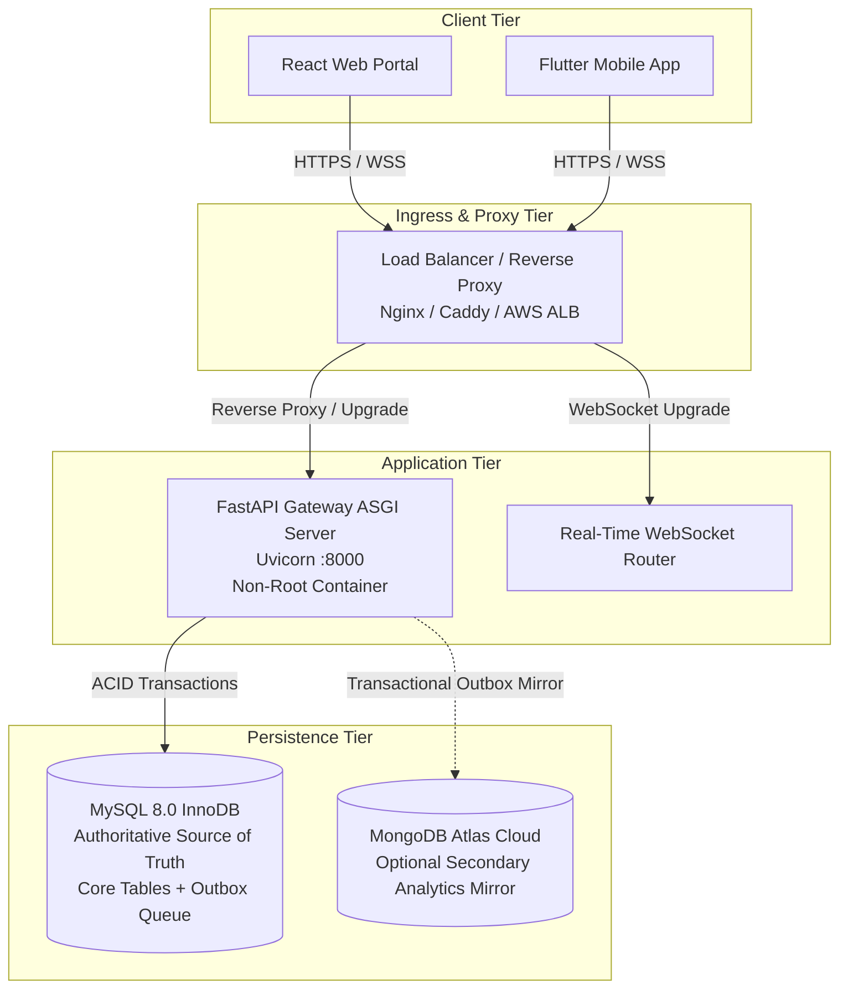

# Production Deployment, Configuration, and Operational Readiness Guide

> [!IMPORTANT]
> **PRODUCTION DEPLOYMENT NOTICE**  
> This runbook defines the controlled, reproducible procedure for deploying the **Smart Health Monitoring System** into staging and production environments. Live deployments must never execute destructive schema resets or run with default development secrets.

---

## 1. System Architecture & Component Inventory

The Smart Health Monitoring System backend operates as a decoupled, multi-tier architecture:



### Component Roles:
1. **FastAPI ASGI Gateway (`services/api`)**: Serves authenticated REST APIs, validates clinical parameters, enforces server-side authorization, evaluates deterministic alert rules, and coordinates transactions.
2. **Authoritative Relational Database (MySQL 8.0 InnoDB)**: Authoritative store for users, profiles, care assignments, vitals readings, clinical alerts, messages, audit logs, and the transactional outbox queue.
3. **Analytics Mirror (MongoDB Atlas)**: Optional secondary document store for high-throughput time-series analytics and multi-tenant aggregations. Non-blocking to clinical workflows.
4. **Real-Time Delivery Engine (`services/websocket`)**: Delivers immediate, patient-scoped telemetry and alert notifications to connected clinical and patient clients.

---

## 2. Infrastructure & Compute Requirements

| Specification | Minimum (Staging / Demo) | Recommended (Production) |
|:---|:---|:---|
| **CPU Architecture** | x86_64 or ARM64 (2 vCPU) | x86_64 or ARM64 (4+ vCPU) |
| **System Memory (RAM)** | 4 GB | 8 GB – 16 GB |
| **Storage (API Gateway)** | 20 GB SSD | 50 GB SSD (NVMe preferred) |
| **Storage (MySQL Data)** | 50 GB SSD | 250+ GB Provisioned IOPS SSD |
| **Operating System** | Ubuntu 22.04 LTS / Debian 12 / RHEL 9 | Container Orchestrator (Docker / Kubernetes / AWS ECS) |
| **Python Runtime** | Python 3.11 or 3.12 | Python 3.12 (Base image: `python:3.12-slim-bookworm`) |

---

## 3. Configuration & Secrets Management

Configuration is handled strictly through environment variables validated at boot time via Pydantic Settings (`services/api/config.py`).

### Setting Classification Matrix:

| Variable Name | Classification | Default Value | Production Requirement |
|:---|:---|:---|:---|
| `APP_ENV` | Non-Secret Setting | `development` | Must be `production` |
| `APP_DEBUG` | Non-Secret Setting | `false` | Must be `false` (Never enable in prod) |
| `API_HOST` | Non-Secret Setting | `127.0.0.1` | `0.0.0.0` in containerized environments |
| `API_PORT` | Non-Secret Setting | `8000` | Typically `8000` behind reverse proxy |
| `CORS_ORIGINS` | Non-Secret Setting | `["http://localhost:5173"]` | Strict whitelist: `["https://health.domain.com"]` |
| `MYSQL_HOST` | Non-Secret Setting | `localhost` | Internal hostname / Private RDS endpoint |
| `MYSQL_PORT` | Non-Secret Setting | `3306` | Standard port 3306 |
| `MYSQL_DATABASE` | Non-Secret Setting | `smart_health` | Production database name |
| `MYSQL_USER` | Non-Secret Setting | `smart_health_app` | Least-privilege application database user |
| `MYSQL_PASSWORD` | **Required Secret** | *None* | Cryptographically random password (min 32 chars) |
| `JWT_SECRET` | **Required Secret** | *Dev default* | Cryptographically random secret (min 32 chars) |
| `JWT_ALGORITHM` | Non-Secret Setting | `HS256` | `HS256` |
| `ACCESS_TOKEN_EXPIRE_MINUTES` | Non-Secret Setting | `60` | Configurable token lifetime (e.g., 30–60 mins) |
| `INGESTION_API_KEY` | **Required Secret** | `dev_simulator_key` | Secure service key for device telemetry ingestion |
| `MONGODB_URI` | Optional Secret | *Empty* | Atlas connection URI (`mongodb+srv://...`) |
| `MONGODB_DATABASE` | Non-Secret Setting | `smart_health_analytics` | Analytics database name |

### Secrets Injection Best Practices:
- **Kubernetes**: Inject secrets via `Secret` resources mapped to container environment variables.
- **AWS / Cloud**: Fetch credentials using AWS Secrets Manager or HashiCorp Vault.
- **NEVER** bake credentials or `.env` files into container image layers.

---

## 4. Container Deployment (Docker & Compose)

### A. Building the Production Container
From the repository root:
```bash
docker build -t smart-health-api:3.0.0 -f Dockerfile .
```

### B. Running with Docker Compose (Local Staging)
1. Copy template and configure environment:
   ```bash
   cp .env.example .env
   # Edit .env with your local secure passwords
   ```
2. Launch database and application containers:
   ```bash
   docker compose up -d --build
   ```
3. Verify running containers:
   ```bash
   docker compose ps
   ```

---

## 5. Bare-Metal & Virtual Machine Deployment (Systemd)

If deploying to a dedicated Linux host without containers:

### 1. System Dependencies & Virtual Environment
```bash
sudo apt-get update && sudo apt-get install -y python3.12 python3.12-venv python3-pip curl

# Create unprivileged application user
sudo useradd -r -s /bin/false -d /opt/smart-health smarthealth

# Create virtual environment
sudo mkdir -p /opt/smart-health
sudo chown -R smarthealth:smarthealth /opt/smart-health
sudo -u smarthealth python3.12 -m venv /opt/smart-health/venv

# Install dependencies
sudo -u smarthealth /opt/smart-health/venv/bin/pip install --upgrade pip
sudo -u smarthealth /opt/smart-health/venv/bin/pip install -r requirements.txt
```

### 2. Systemd Service Unit (`/etc/systemd/system/smart-health.service`)
```ini
[Unit]
Description=Smart Health Monitoring System API Gateway
After=network.target mysql.service

[Service]
Type=simple
User=smarthealth
Group=smarthealth
WorkingDirectory=/opt/smart-health
EnvironmentFile=/etc/smart-health/production.env
ExecStart=/opt/smart-health/venv/bin/uvicorn services.api.main:app --host 127.0.0.1 --port 8000 --proxy-headers --forwarded-allow-ips=*
Restart=always
RestartSec=5s
LimitNOFILE=65536

[Install]
WantedBy=multi-user.target
```

### 3. Enable and Start Service
```bash
sudo systemctl daemon-reload
sudo systemctl enable --now smart-health
sudo systemctl status smart-health
```

---

## 6. Reverse Proxy Configuration (Nginx)

Place Nginx in front of Uvicorn for SSL/TLS termination, request rate limiting, and WebSocket proxying:

```nginx
server {
    listen 443 ssl http2;
    server_name health.yourdomain.com;

    ssl_certificate /etc/letsencrypt/live/health.yourdomain.com/fullchain.pem;
    ssl_certificate_key /etc/letsencrypt/live/health.yourdomain.com/privkey.pem;
    ssl_protocols TLSv1.2 TLSv1.3;
    ssl_ciphers HIGH:!aNULL:!MD5;

    client_max_body_size 10M;

    # Standard REST API endpoints
    location / {
        proxy_pass http://127.0.0.1:8000;
        proxy_set_header Host $host;
        proxy_set_header X-Real-IP $remote_addr;
        proxy_set_header X-Forwarded-For $proxy_add_x_forwarded_for;
        proxy_set_header X-Forwarded-Proto $scheme;
    }

    # WebSocket Real-Time Endpoint Upgrade
    location /ws {
        proxy_pass http://127.0.0.1:8000/ws;
        proxy_http_version 1.1;
        proxy_set_header Upgrade $http_upgrade;
        proxy_set_header Connection "Upgrade";
        proxy_set_header Host $host;
        proxy_set_header X-Real-IP $remote_addr;
        proxy_read_timeout 3600s;
        proxy_send_timeout 3600s;
    }
}
```

---

## 7. Database Migration Runbook (Alembic)

> [!WARNING]
> Never apply migrations directly without backing up the target database first. Verify revisions offline using dry-run SQL.

### Step 1: Check Current Database Revision
```bash
python -m alembic current
```

### Step 2: Generate Dry-Run SQL (Verify Offline DDL)
```bash
python -m alembic upgrade head --sql
```

### Step 3: Apply Migrations to Target Database
```bash
python -m alembic upgrade head
```

### Step 4: Verify Migration History
```bash
python -m alembic history --verbose
```

---

## 8. Operational Health & Readiness Probes

The system provides dedicated endpoints conforming to standard container orchestration specifications:

### 1. Process Liveness Probe (`GET /health/live`)
- **Purpose**: Checks that the Python process and ASGI event loop are responsive.
- **Dependency Checks**: Zero external network checks.
- **Expected Return**: HTTP 200 OK:
  ```json
  {
    "status": "alive",
    "service": "Smart Health Monitoring System",
    "version": "3.0.0"
  }
  ```

### 2. Operational Readiness Probe (`GET /health/ready`)
- **Purpose**: Validates that authoritative dependencies are connected before routing user traffic.
- **Dependency Checks**: Exercises live MySQL connection pool check (`SELECT 1`). Reports MongoDB status without gating readiness.
- **Expected Return (Healthy)**: HTTP 200 OK:
  ```json
  {
    "status": "ready",
    "database": "connected",
    "mongodb_mirror": "connected",
    "message": "Authoritative database operational. Ready to serve traffic."
  }
  ```
- **Expected Return (Database Outage)**: HTTP 503 Service Unavailable:
  ```json
  {
    "status": "unready",
    "database": "unreachable",
    "message": "Authoritative relational database is unavailable."
  }
  ```

---

## 9. Pre-Deployment Verification Checklist

Before releasing a new revision to production, complete each verification step:

- [ ] **No Secrets in Code**: Checked `git diff` for hardcoded keys, tokens, or connection strings.
- [ ] **Environment File Configured**: `APP_ENV=production`, `APP_DEBUG=false`, and random secrets set.
- [ ] **CORS Configured**: `CORS_ORIGINS` restricted to verified production domains.
- [ ] **Database Backup Taken**: Full MySQL logical backup executed prior to migration.
- [ ] **Migrations Verified**: `alembic upgrade head --sql` reviewed and approved by DBA.
- [ ] **Migrations Applied**: `alembic upgrade head` executed cleanly.
- [ ] **Automated Tests Passing**: Full pytest suite verified (210/210 passing).
- [ ] **Readiness Probe Responding**: `curl -I https://health.yourdomain.com/health/ready` returns 200 OK.
- [ ] **SSL/TLS Verified**: A+ grade on Qualys SSL Labs; HTTP redirects to HTTPS.
- [ ] **WebSocket Connected**: `/ws` connects cleanly through reverse proxy with valid JWT.

---

## 10. Post-Deployment Smoke Test Runbook

Execute these synthetic validation checks immediately following a deployment:

1. **Verify Liveness**:
   ```bash
   curl -f -s https://health.yourdomain.com/health/live
   ```
2. **Verify Readiness**:
   ```bash
   curl -f -s https://health.yourdomain.com/health/ready
   ```
3. **Verify Auth API**:
   ```bash
   curl -X POST https://health.yourdomain.com/api/v1/auth/login \
     -H "Content-Type: application/json" \
     -d '{"email":"admin@hospital.org","password":"ValidAdminPassword123!"}'
   ```
4. **Verify WebSocket Handshake**:
   Connect via test client using obtained Bearer token and confirm `connection_established` payload.
