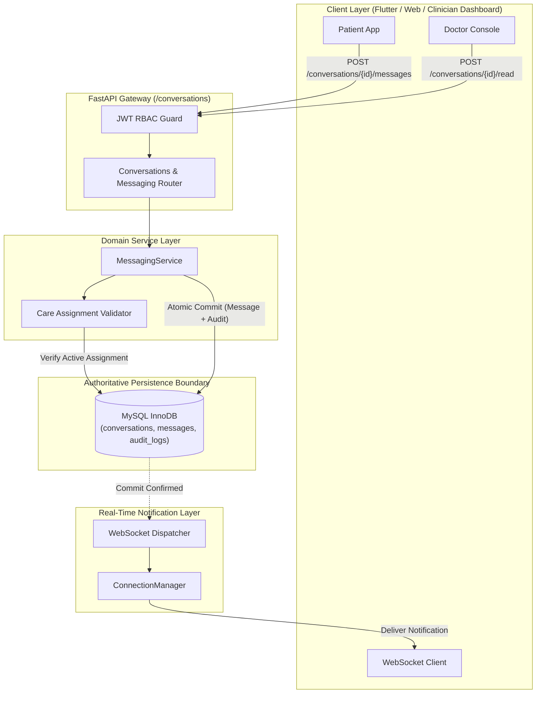

# Secure Clinical Messaging, Conversations, and Real-Time Delivery

> [!CAUTION]
> **PROVISIONAL DEMONSTRATION MESSAGING — NOT FOR EMERGENCY CLINICAL USE**  
> All messaging, direct communications, and notification pipelines documented herein are designed solely for software engineering verification, testing, and simulated telemetry pipelines. This subsystem is NOT certified for life-critical patient communications or emergency response.

---

## 1. Architectural Overview & Core Principles

The Smart Health Monitoring System implements a relational, transactionally consistent, and secure patient–clinician messaging subsystem.



### Core Design Tenets:
1. **Authoritative Persistence in MySQL**:
   - MySQL is the single source of truth for conversations, messages, read states, and compliance audit logs.
   - Messages are never stored in MongoDB as authoritative records.
2. **Explicit Participant Scoping & Care Assignments**:
   - Conversations exist exclusively between an authorized patient and clinician.
   - Creation and active communication require a verified active record in `doctor_patient_assignments`.
   - Client-supplied sender IDs or participant lists are never trusted; identity is resolved entirely server-side from the authenticated JWT token context.
3. **Care Assignment Revocation Policy**:
   - If a clinician's care assignment to a patient is deactivated (`is_active=False` or deleted), historical messages remain accessible read-only for medical record continuity and legal audit.
   - Sending new messages in a revoked conversation is immediately blocked (`403 Forbidden`).
4. **Idempotency & Safe Retries**:
   - Clients may supply an optional `idempotency_key` (up to 64 characters).
   - Exact duplicate retries return the original persisted message without generating duplicates.
   - Conflicting reuse of an idempotency key with differing content or conversation is rejected (`409 Conflict`).
5. **Decoupled Real-Time Notifications**:
   - WebSockets deliver lightweight notification envelopes (`message.created`, `message.read`) to the patient room *strictly after* the MySQL transaction commits.
   - Notification failures never invalidate or roll back the committed message.

---

## 2. Conversation & Message Schema

### `conversations` Table
| Column | Type | Constraints | Description |
| :--- | :--- | :--- | :--- |
| `conversation_id` | `VARCHAR(64)` | `PRIMARY KEY` | Deterministic or unique identifier (`conv_<patient_id>_<doctor_id>`) |
| `patient_id` | `VARCHAR(32)` | `NOT NULL, FK -> patient_profiles.patient_id ON DELETE CASCADE` | Assigned patient domain ID |
| `doctor_id` | `VARCHAR(32)` | `NOT NULL, FK -> doctor_profiles.doctor_id ON DELETE CASCADE` | Assigned doctor domain ID |
| `is_active` | `BOOLEAN` | `NOT NULL, DEFAULT TRUE` | Active channel indicator |
| `created_at` | `TIMESTAMP` | `NOT NULL, DEFAULT CURRENT_TIMESTAMP` | Channel creation timestamp |
| `updated_at` | `TIMESTAMP` | `NOT NULL, DEFAULT CURRENT_TIMESTAMP ON UPDATE CURRENT_TIMESTAMP` | Latest activity timestamp |

**Table Constraints**:
- `UNIQUE (patient_id, doctor_id)` (`uq_conversations_patient_doctor`): Ensures exactly one canonical conversation per participant pair.
- Indexes: `idx_conversations_patient`, `idx_conversations_doctor`, `idx_conversations_updated`.

### `messages` Table
| Column | Type | Constraints | Description |
| :--- | :--- | :--- | :--- |
| `message_id` | `VARCHAR(64)` | `PRIMARY KEY` | Monotonic identifier (`msg_<microseconds>_<uuid8>`) |
| `conversation_id` | `VARCHAR(64)` | `FK -> conversations.conversation_id ON DELETE CASCADE` | Parent conversation channel |
| `sender_id` | `VARCHAR(64)` | `NOT NULL, FK -> users.user_id ON DELETE CASCADE` | Authenticated sender user ID |
| `receiver_id` | `VARCHAR(64)` | `NOT NULL, FK -> users.user_id ON DELETE CASCADE` | Intended recipient user ID |
| `patient_context_id` | `VARCHAR(32)` | `FK -> patient_profiles.patient_id ON DELETE SET NULL` | Clinical context patient ID |
| `content` | `TEXT` | `NOT NULL` | Validated message body (1 to 2000 characters) |
| `is_read` | `BOOLEAN` | `NOT NULL, DEFAULT FALSE` | Read status indicator |
| `idempotency_key` | `VARCHAR(64)` | `NULLABLE` | Client idempotency identifier |
| `created_at` | `TIMESTAMP` | `NOT NULL, DEFAULT CURRENT_TIMESTAMP` | Server-assigned creation timestamp |
| `read_at` | `TIMESTAMP` | `NULLABLE` | Server-assigned read timestamp in UTC |

**Table Constraints**:
- `UNIQUE (sender_id, idempotency_key)` (`uq_messages_sender_idempotency`): Guarantees safe retries per sender.
- Indexes: `idx_messages_receiver_read_time`, `idx_messages_sender_time`, `idx_messages_conversation_time`, `idx_messages_conversation_unread`.

---

## 3. API Endpoints & Request/Response Contracts

All routes are mounted at both `/api/v1/conversations` and `/conversations`.

### A. List Conversations
`GET /conversations`
- **Query Parameters**:
  - `page`: int (default `1`, $\ge 1$)
  - `page_size`: int (default `20`, $1 \le \text{page\_size} \le 100$)
- **Authorization**:
  - Patients receive conversations where they are the patient participant.
  - Clinicians receive conversations where they are the assigned doctor.
  - Administrators receive all active conversations.
- **Response (`200 OK`)**:
  ```json
  {
    "items": [
      {
        "conversation_id": "conv_P101_DOC_001",
        "patient_id": "P101",
        "doctor_id": "DOC_001",
        "patient_name": "Alice Smith",
        "doctor_name": "Dr. Carol Danvers",
        "is_active": true,
        "unread_count": 2,
        "last_message": {
          "message_id": "msg_1791910000000_a1b2c3d4",
          "sender_id": "usr_alice",
          "preview": "Hello Doctor Carol, my vitals are updated.",
          "created_at": "2026-10-14T00:30:00+00:00"
        },
        "created_at": "2026-10-14T00:00:00+00:00",
        "updated_at": "2026-10-14T00:30:00+00:00"
      }
    ],
    "total_count": 1,
    "page": 1,
    "page_size": 20,
    "total_pages": 1,
    "has_next": false,
    "has_previous": false
  }
  ```

### B. Create or Retrieve Conversation
`POST /conversations`
- **Request Body (Patient)**:
  ```json
  {"doctor_id": "DOC_001"}
  ```
- **Request Body (Clinician)**:
  ```json
  {"patient_id": "P101"}
  ```
- **Response (`201 Created`)**:
  Returns `ConversationResponse`. If the conversation already exists, returns the existing record idempotently.

### C. Retrieve Individual Conversation
`GET /conversations/{conversation_id}`
- **Response (`200 OK`)**: Returns `ConversationResponse`.
- **Errors**: `403 Forbidden` if not a participant; `404 Not Found` if nonexistent.

### D. List Messages in Conversation
`GET /conversations/{conversation_id}/messages`
- **Query Parameters**:
  - `page`: int (default `1`)
  - `page_size`: int (default `20`, max `100`)
  - `order`: string (`asc` or `desc`, default `asc`)
- **Response (`200 OK`)**:
  ```json
  {
    "items": [
      {
        "message_id": "msg_1791910000000_a1b2c3d4",
        "conversation_id": "conv_P101_DOC_001",
        "sender_id": "usr_alice",
        "receiver_id": "usr_carol",
        "patient_context_id": "P101",
        "content": "Hello Doctor Carol, my vitals are updated.",
        "is_read": true,
        "idempotency_key": "alice_client_key_001",
        "created_at": "2026-10-14T00:30:00+00:00",
        "read_at": "2026-10-14T00:32:15+00:00"
      }
    ],
    "total_count": 1,
    "page": 1,
    "page_size": 20,
    "total_pages": 1,
    "has_next": false,
    "has_previous": false
  }
  ```

### E. Send Message
`POST /conversations/{conversation_id}/messages`
- **Request Body**:
  ```json
  {
    "content": "Please take your prescribed medication and rest.",
    "idempotency_key": "doc_send_key_1002"
  }
  ```
- **Validation**:
  - `content`: Non-empty, non-whitespace, 1–2000 characters.
  - `idempotency_key`: Optional string, 1–64 characters.
- **Response (`201 Created`)**: Returns `MessageResponse`.

### F. Mark Messages as Read
`POST /conversations/{conversation_id}/read`
- **Request Body (Optional)**:
  ```json
  {"message_ids": ["msg_1791910000000_a1b2c3d4"]}
  ```
  *(If omitted or empty `{}`: marks all incoming unread messages in the conversation as read)*.
- **Response (`200 OK`)**:
  ```json
  {
    "status": "success",
    "conversation_id": "conv_P101_DOC_001",
    "messages_marked_read": 1,
    "read_at": "2026-10-14T00:32:15.123456+00:00"
  }
  ```

---

## 4. Read Status & Delivery Model

1. **Directional Safety**:
   - Senders cannot mark their own outgoing messages as read on behalf of the recipient.
   - Only messages where `receiver_id == current_user.user_id` are eligible for read transition.
2. **Server-Generated Timestamps**:
   - `read_at` is assigned by the server using `datetime.now(timezone.utc)` at transaction execution time.
3. **Delivery vs. Read Differentiation**:
   - **Stored**: Message committed in MySQL (`is_read=False`).
   - **Dispatched**: Real-time `message.created` event pushed to active WebSocket subscribers.
   - **Read**: Explicit `POST /conversations/{id}/read` received and committed with timestamp.

---

## 5. Real-Time WebSocket Event Delivery

Integrated with the Part 2I WebSocket infrastructure:

### Outbound Event: `message.created`
Dispatched to the target patient's room when a new message is committed in MySQL:
```json
{
  "event_id": "ws_evt_d4e5f6a7b8c9d0e1",
  "event_type": "message.created",
  "schema_version": 1,
  "occurred_at": "2026-10-14T00:30:00.000000+00:00",
  "patient_id": "P101",
  "resource_id": "msg_1791910000000_a1b2c3d4",
  "payload": {
    "conversation_id": "conv_P101_DOC_001",
    "message_id": "msg_1791910000000_a1b2c3d4",
    "sender_id": "usr_alice",
    "receiver_id": "usr_carol",
    "created_at": "2026-10-14T00:30:00.000000+00:00"
  }
}
```

### Outbound Event: `message.read`
Dispatched when incoming messages are marked as read:
```json
{
  "event_id": "ws_evt_e5f6a7b8c9d0e1f2",
  "event_type": "message.read",
  "schema_version": 1,
  "occurred_at": "2026-10-14T00:32:15.000000+00:00",
  "patient_id": "P101",
  "resource_id": "conv_P101_DOC_001",
  "payload": {
    "conversation_id": "conv_P101_DOC_001",
    "read_by": "usr_carol",
    "messages_marked_read": 1,
    "read_at": "2026-10-14T00:32:15.000000+00:00"
  }
}
```

---

## 6. Audit Trail & Zero-Secret Policy

All critical messaging actions are recorded in `audit_logs` within the same transaction:

| Action | Target Type | Target ID | Logged Metadata |
| :--- | :--- | :--- | :--- |
| `CONVERSATION_CREATE` | `conversation` | `conversation_id` | `{"patient_id": "...", "doctor_id": "..."}` |
| `MESSAGE_SEND` | `message` | `message_id` | `{"conversation_id": "...", "receiver_id": "...", "char_count": N}` |
| `MESSAGES_MARK_READ` | `conversation` | `conversation_id` | `{"messages_count": N}` |

> [!NOTE]
> To preserve patient privacy and prevent sensitive clinical discussions from leaking into operations logging, full message text is **never stored** in the `metadata_json` column of `audit_logs`. Only message length and participant IDs are recorded.

---

## 7. Automated Test Suite & Verification

The messaging implementation is fully verified with 24 dedicated unit and integration tests in `tests/unit/test_messaging.py`.

Run command:
```powershell
& "C:\Program Files\Python312\python.exe" -m pytest tests/unit/test_messaging.py -v
```

Total project test suite passes **185 out of 185 tests** in under 10 seconds.
