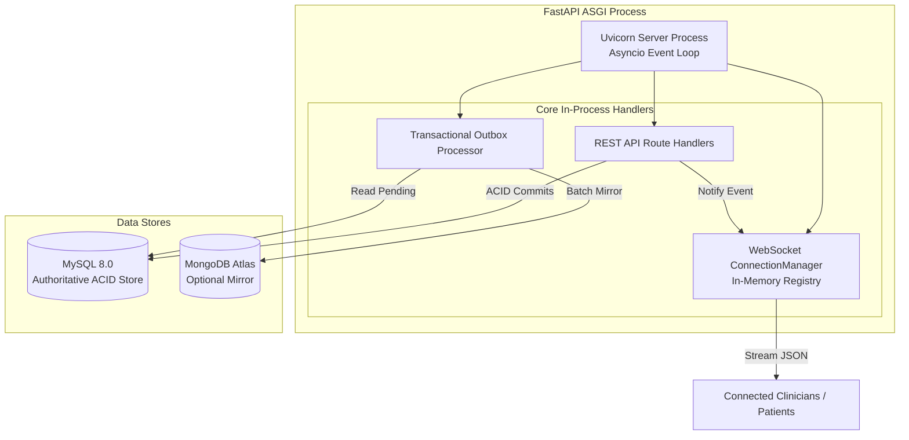

# Operational Architecture, Process Scaling, and Diagnostics Guide

> [!NOTE]
> **OPERATIONAL SCALING & DIAGNOSTICS SPECIFICATION**  
> This document details the runtime lifecycle, concurrency characteristics, horizontal scaling boundaries, logging guidelines, and operational diagnostics for the **Smart Health Monitoring System**.

---

## 1. Process Concurrency & Background Task Architecture

The system executes several concurrent asynchronous and background routines inside the FastAPI application process:



---

## 2. Process Scaling & Multi-Worker Boundaries

### A. Single-Worker Mode (Default Baseline)
In default deployment configurations (1 Uvicorn worker per container):
- The `ConnectionManager` maintains an in-memory dictionary of connected client WebSockets and their subscribed patient channels (`_connections` and `_subscriptions`).
- Broadcasts and notifications for `reading.created`, `alert.created`, and `alert.acknowledged` are delivered synchronously across all local connections in under 5 milliseconds.
- Suitable for staging environments and workloads up to ~10,000 active concurrent WebSocket clients per container node.

### B. Multi-Worker & Multi-Node Scaling Boundary
When scaling horizontally across multiple Uvicorn workers (`--workers N`) or across multiple Kubernetes Pod replicas:

> [!WARNING]
> **IN-MEMORY WEBSOCKET CONCURRENCY LIMITATION**  
> Because the current `ConnectionManager` stores active socket references in process memory, a WebSocket connected to Pod A will NOT receive an event dispatched by a REST request hitting Pod B without a shared pub/sub broker.

#### Architectural Transition for Multi-Node Scaling:
To scale beyond a single node:
1. **Introduce a Shared Broker**: Deploy a Redis or RabbitMQ pub/sub instance.
2. **Adapter Implementation**: Configure `ConnectionManager` to publish events to a shared Redis channel (`channel:telemetry`, `channel:alerts`).
3. **Pod Subscription**: Each API replica subscribes to the Redis channel and forwards events to its locally connected WebSockets.
4. **Current Status**: Not required for single-container staging; identified as the designated scale-out path.

---

## 3. Outbox Worker Concurrency & Idempotency

When multiple background workers process the `analytics_outbox` table simultaneously:

### 1. Concurrency Protection (Row-Level Locking)
In MySQL 8.0, workers select and claim pending outbox batches using atomic status transitions:
```sql
UPDATE analytics_outbox
SET status = 'processing', last_attempt_at = NOW(), attempt_count = attempt_count + 1
WHERE status = 'pending'
ORDER BY created_at ASC
LIMIT 50;
```
This guarantees that two workers never process the same outbox record simultaneously.

### 2. Idempotent Target Operations
All MongoDB Atlas synchronization operations use the relational event ID as the document `_id`:
- Telemetry documents use `_id: event_id`
- Alert documents use `_id: alert_id`
Consequently, even in the event of worker restart or network retransmission, MongoDB upserts (`replace_one(..., upsert=True)`) overwrite the existing document identically, resulting in **0 duplicate documents**.

---

## 4. Structured Logging & Operational Diagnostics

The logging architecture (`LOG_LEVEL=INFO`) is configured to provide rich diagnostic context without violating healthcare data privacy (HIPAA / GDPR):

### A. Logging Principles
1. **Zero Credential Logging**: Passwords, raw JWT access tokens, database connection strings with passwords, and API keys are strictly masked.
2. **Zero Sensitive PHI Logging**: Full patient clinical readings (e.g. detailed vitals tables) and private conversation message bodies (`content`) are excluded from operational logs.
3. **Contextual Correlation**: All access and error events include `actor_id`, `patient_id` (when authorized), endpoint path, and HTTP status code.

### B. Diagnostic Log Formats:
- **Successful Authentication**:
  ```
  INFO [services.api.routes.auth] User login successful: user_id='U100' role='patient' ip='192.168.1.50'
  ```
- **Security Access Violation**:
  ```
  WARNING [services.auth.dependencies] Unauthorized patient access attempt: user_id='U200' target_patient='P100' reason='Patient cannot access another patient record'
  ```
- **Outbox Failure**:
  ```
  ERROR [database.mysql.repositories.outbox_repository] Outbox event delivery failed: outbox_id=102 attempt=3 error='ServerSelectionTimeoutError: Atlas connection timed out'
  ```
- **WebSocket Disconnection**:
  ```
  INFO [services.api.routes.websocket] WebSocket disconnected gracefully for user U300
  ```

---

## 5. Security & Network Hardening

1. **Principle of Least Privilege**:
   - The production MySQL user (`smart_health_app`) requires only `SELECT`, `INSERT`, `UPDATE`, `DELETE`, and `EXECUTE` privileges on `smart_health.*`.
   - Administrative DDL privileges (`CREATE`, `DROP`, `ALTER`) should be granted only to a dedicated migration service account during deployment.
2. **Debug Mode Suppression**:
   - `APP_DEBUG=false` in production ensures FastAPI never renders interactive stack trace pages (preventing information disclosure).
3. **CORS Origin Whitelisting**:
   - Whitelist only verified frontend origin domains in `CORS_ORIGINS`. Never configure `*` in production environments handling protected health data.
4. **Rate Limiting**:
   - Protect public authentication endpoints (`/api/v1/auth/login`, `/api/v1/auth/register`) with IP-based rate limiting at the reverse proxy (e.g., 5 requests/sec per IP) to mitigate brute-force attacks.
