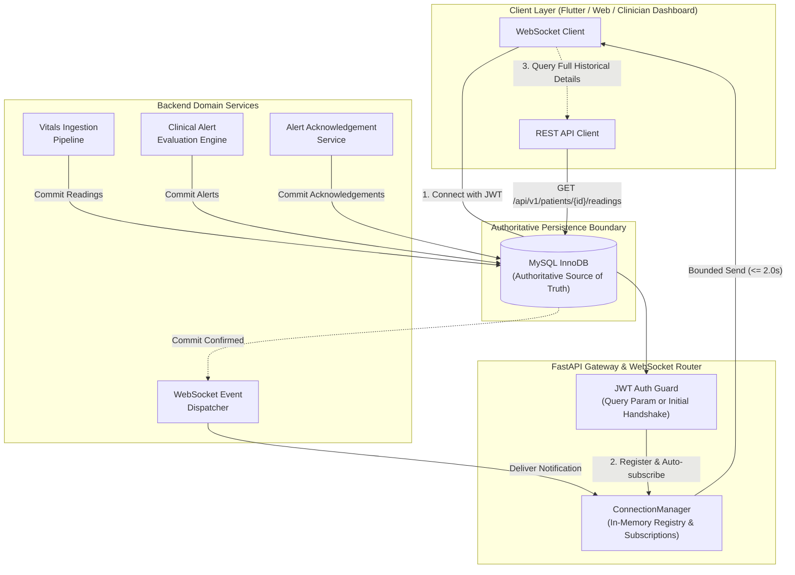
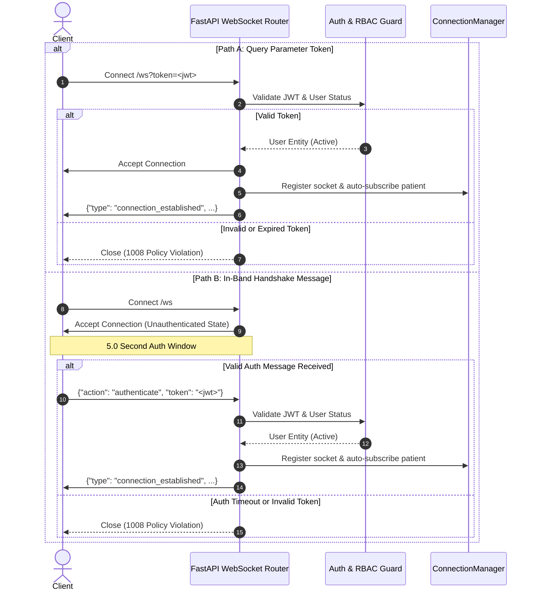

# Real-Time WebSockets Architecture, Secure Delivery, and Event Protocol

> [!CAUTION]
> **PROVISIONAL DEMONSTRATION TELEMETRY — NOT FOR MEDICAL USE OR EMERGENCY RESPONSE**  
> All real-time telemetry streaming, alerting, and event notifications documented herein are intended strictly for software engineering verification, testing, and simulated telemetry pipelines. This system is NOT certified as a medical device or life-critical monitoring platform.

---

## 1. Architectural Overview & Core Principles

The Smart Health Monitoring System implements an asynchronous, secure WebSocket notification layer for real-time health telemetry updates and clinical alerts.



### Core Design Tenets:

1. **Authoritative Persistence Boundary**:
   - WebSockets are a **notification delivery channel**, not an authoritative data store.
   - Notifications are dispatched **strictly after** the underlying MySQL transaction has committed.
   - If notification delivery fails, client disconnects, or network partitions occur, the authoritative state in MySQL remains untouched.
2. **Minimal Notification Payloads**:
   - Notifications contain resource identifiers, metadata, and state tags.
   - Clients use the notification `resource_id` or `patient_id` to query full authoritative details through standard REST endpoints (`/patients/{id}/readings`, `/alerts/{id}`).
3. **Strict Server-Side Authorization**:
   - WebSocket connections enforce the exact same Role-Based Access Control (RBAC) and patient-clinician assignment rules as the REST API.
   - Patients can only subscribe to their own telemetry stream.
   - Clinicians can only subscribe to patients actively assigned to them in `doctor_patient_assignments`.
   - Administrative operators retain system-wide operational visibility.
4. **Slow-Client Isolation**:
   - Broadcasts to subscribers enforce an individual send timeout (2.0 seconds).
   - Hung or lagging sockets are disconnected and removed without blocking or slowing event delivery to healthy subscribers.

---

## 2. Endpoints & Protocol Specification

### Endpoints
- `/ws`: Primary WebSocket endpoint.
- `/api/v1/ws`: Versioned API alias for gateway routing parity.

### Handshake Protocol & Authentication

The gateway supports dual authentication workflows to support browser environments, Flutter apps, and API gateways:



---

## 3. Inbound Client Actions

All inbound messages from clients must be formatted as UTF-8 encoded JSON objects under 64 KB in size.

### 1. Ping / Keepalive
Used to verify link health and reset intermediary proxy idle timers.
- **Inbound Message**:
  ```json
  {"action": "ping"}
  ```
- **Outbound Response**:
  ```json
  {
    "type": "pong",
    "timestamp": "2026-10-13T23:30:00.123456+00:00"
  }
  ```

### 2. Subscribe to Patient Stream
Clinicians (or admins) subscribe to real-time events for a specific patient.
- **Inbound Message**:
  ```json
  {"action": "subscribe", "patient_id": "P101"}
  ```
- **Success Response**:
  ```json
  {
    "type": "subscription_success",
    "patient_id": "P101",
    "timestamp": "2026-10-13T23:30:00.123456+00:00"
  }
  ```
- **Forbidden Response (Unassigned Clinician or Cross-Patient Access)**:
  ```json
  {
    "type": "error",
    "code": "SUBSCRIPTION_FORBIDDEN",
    "detail": "Access denied: Doctor DOC_002 is not assigned to patient P101.",
    "patient_id": "P101"
  }
  ```

### 3. Unsubscribe from Patient Stream
Relinquishes subscription to a patient stream.
- **Inbound Message**:
  ```json
  {"action": "unsubscribe", "patient_id": "P101"}
  ```
- **Success Response**:
  ```json
  {
    "type": "unsubscription_success",
    "patient_id": "P101",
    "timestamp": "2026-10-13T23:30:00.123456+00:00"
  }
  ```

---

## 4. Outbound Real-Time Event Envelopes

Every outbound event conforms to the `RealtimeEvent` envelope:

| Field | Type | Description |
| :--- | :--- | :--- |
| `event_id` | string | Unique notification identifier (`ws_evt_<uuid16>`). |
| `event_type` | string | Domain event category (`reading.created`, `alert.created`, `alert.acknowledged`). |
| `schema_version` | integer | Envelope schema version (currently `1`). |
| `occurred_at` | string (ISO 8601) | Timestamp of event occurrence in UTC. |
| `patient_id` | string | Target patient domain identifier. |
| `resource_id` | string | Authoritative MySQL primary key of the aggregate. |
| `payload` | object | Event-specific metadata. |

### Event Type: `reading.created`
Dispatched when a new live telemetry reading is committed in MySQL.
```json
{
  "event_id": "ws_evt_a1b2c3d4e5f60718",
  "event_type": "reading.created",
  "schema_version": 1,
  "occurred_at": "2026-10-13T23:30:00.000000+00:00",
  "patient_id": "P101",
  "resource_id": "evt_live_7890",
  "payload": {
    "source": "wearable",
    "is_simulated": true,
    "metrics": ["heart_rate", "spo2"]
  }
}
```

### Event Type: `alert.created`
Dispatched when clinical thresholds are breached and a new alert is generated.
```json
{
  "event_id": "ws_evt_b2c3d4e5f6a7b8c9",
  "event_type": "alert.created",
  "schema_version": 1,
  "occurred_at": "2026-10-13T23:30:01.000000+00:00",
  "patient_id": "P101",
  "resource_id": "alt_f3a74b89e210cd45",
  "payload": {
    "rule_id": "RULE_HR_HIGH",
    "severity": "HIGH",
    "category": "cardiac",
    "status": "NEW",
    "reason": "[HIGH] Heart rate exceeds tachycardia threshold. Observed: 112 bpm."
  }
}
```

### Event Type: `alert.acknowledged`
Dispatched when a clinician reviews and acknowledges an alert.
```json
{
  "event_id": "ws_evt_c3d4e5f6a7b8c9d0",
  "event_type": "alert.acknowledged",
  "schema_version": 1,
  "occurred_at": "2026-10-13T23:32:15.000000+00:00",
  "patient_id": "P101",
  "resource_id": "alt_f3a74b89e210cd45",
  "payload": {
    "status": "ACKNOWLEDGED",
    "acknowledged_by": "DOC_001",
    "acknowledged_at": "2026-10-13T23:32:15.000000+00:00",
    "note": "Clinician attending patient at bedside."
  }
}
```

---

## 5. Resilience, Isolation, and Error Handling

### Inbound Message Guardrails
- **Payload Size Cap**: 64 KB (`MAX_MESSAGE_BYTES = 65536`). Oversized messages are rejected with `MESSAGE_TOO_LARGE` without terminating the socket.
- **JSON Validation**: Malformed JSON triggers `MALFORMED_JSON` error response.
- **Authentication Timeout**: In unauthenticated mode, failure to send valid credentials within 5.0 seconds triggers immediate socket closure (code `1008 Policy Violation`).

### Outbound Broadcast Isolation
- **Bounded Send**: `asyncio.wait_for(ws.send_text(...), timeout=2.0)` isolates slow or dead connections.
- **Automatic Garbage Collection**: Sockets that fail during a send or encounter timeouts are marked as dead and pruned from all subscriber groups via `connection_manager.disconnect()`.
- **Graceful Shutdown**: During application shutdown, the FastAPI lifespan calls `await connection_manager.close_all(code=1001, reason="Server shutting down")` to cleanly release all client connections.

---

## 6. Deployment Architecture & Horizontal Scaling Roadmap

> [!NOTE]
> The current `ConnectionManager` is an **in-memory implementation** optimized for single-process deployments (such as Antigravity local development and single-container deployments).

### Single-Process vs Multi-Process Trade-offs

| Component | In-Memory (Current) | Multi-Worker / Multi-Host (Scale-Out) |
| :--- | :--- | :--- |
| **State Storage** | Process RAM (`asyncio.Lock`, Python `set`) | Distributed Cache / PubSub (Redis, Valkey, NATS) |
| **Cross-Worker Routing** | Single ASGI event loop | PubSub Channel per Patient (`patient:{id}:events`) |
| **Latency** | Sub-millisecond direct delivery | Low-latency (~1-2 ms network hop) |
| **External Dependencies** | None (Zero external infrastructure required) | Redis or message broker container required |

### Horizontal Scaling Migration Path
When scaling horizontally across multiple Uvicorn worker processes or container instances:
1. Replace `ConnectionManager`'s local dispatch with a Redis PubSub subscriber (`aioredis` / `redis-py`).
2. Each worker node subscribes to channels for patients connected to that specific worker.
3. Event publishers (`dispatcher.py`) publish events to the Redis channel `patient:{patient_id}:events`.
4. The Redis subscriber on each worker forwards the event to local WebSocket subscribers.

---

## 7. Client Reconnection Guidelines

Client implementations (Flutter and React) must observe the following lifecycle guidelines:

1. **Reconnection with Backoff**:
   - Upon connection loss or closure (`code != 1000`), clients should attempt reconnection using exponential backoff with jitter (e.g., initial delay 1.0s, doubling up to a maximum of 30.0s).
2. **Post-Reconnect State Reconciliation**:
   - Because real-time notifications might have occurred during the disconnection window, clients **must never assume zero event loss** while disconnected.
   - Upon successful reconnection, the client should query the REST API to fetch the latest state:
     - `GET /api/v1/patients/{patient_id}/readings/latest`
     - `GET /api/v1/alerts?patient_id={patient_id}&status=NEW`
3. **Token Expiration Handling**:
   - If the WebSocket closes with code `1008` (Policy Violation), the client should check if its JWT access token is expired, refresh it via `POST /api/v1/auth/refresh` (or login), and establish a new connection with the fresh token.
