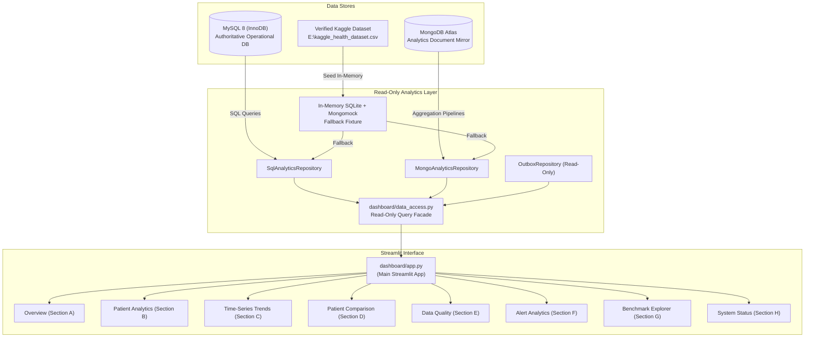

# Streamlit Analytics & Evidence Dashboard (Part 3D)

## 1. Overview & Purpose

The **Streamlit Analytics Dashboard** serves as the primary analytics and coursework-evidence interface for the **Smart Health Monitoring System**. It complements the operational FastAPI backend and the React clinician application by providing:

- Population-level telemetry analytics and vital signs summaries.
- Independent, high-contrast time-series charts (Heart Rate in bpm, SpO2 in %, Body Temperature in °F) across hourly and daily aggregation intervals.
- Cross-patient variance comparisons evaluated across identical temporal boundaries.
- Relational-to-document data quality audits, boundary violation checks, and duplicate detection.
- Clinical alert triage and response lifecycle monitoring.
- Interactive **SQL vs. NoSQL Performance Benchmark Explorer** loading empirical artifacts generated in Part 3C.
- System infrastructure connectivity probes and transactional mirror synchronization metrics.

> **Clinical Disclaimer:** This dashboard is an analytical and coursework demonstration tool. Summaries and aggregations are computed directly from authoritative database records and do not constitute primary medical diagnostic conclusions.

---

## 2. Architecture & Data Flow



---

## 3. Dashboard Structure & Sections

| Section | Identifier | Purpose & Core Metrics | Data Sources |
|---|---|---|---|
| **A. Overview** | `Overview` | High-level population counts, total telemetry events, distinct patients, time coverage boundaries, data completeness score, and connectivity badges. | `SqlAnalyticsRepository.get_dataset_overview()`, `MongoAnalyticsRepository.get_dataset_overview()` |
| **B. Patient Analytics** | `Patient Analytics` | Individual patient vital signs baseline statistics (min, max, avg, observation counts for HR in bpm, SpO2 in %, Temp in °F) and bounded chronological history. | `get_patient_vitals_summary()`, `get_patient_telemetry_history()` |
| **C. Time-Series Trends** | `Time-Series Trends` | Chronological multi-channel trends with independent vertical scales, hourly/daily intervals, min/max envelopes, and honest missing interval gaps without artificial smoothing. | `get_time_bucketed_vitals()` |
| **D. Patient Comparison** | `Patient Comparison` | Cross-patient population comparisons across identical time windows and metrics, with side-by-side bar charts and tabular statistical summaries. | `get_patient_vitals_summary(patient_id=None)` |
| **E. Data Quality** | `Data Quality` | Quality audit diagnostics: essential field completeness, physiological boundary violations (HR 30-250 bpm, SpO2 50-100%, Temp 90-115°F), duplicate detection, and MySQL vs MongoDB mirror reconciliation. | `get_data_quality_report()`, `fetch_database_reconciliation()` |
| **F. Alert Analytics** | `Clinical Alerts` | Real clinical alert distributions by severity tier (CRITICAL, HIGH, MEDIUM, LOW), lifecycle status, clinician acknowledgement rates, and patient-level alert frequency. | `SqlAnalyticsRepository.get_alert_summary()` |
| **G. Benchmarks** | `SQL vs NoSQL Benchmarks` | Interactive explorer for Part 3C benchmark execution artifacts (`benchmarks/results/bench_*.json`), comparing MySQL vs MongoDB median/p95 latency, speed ratios, mathematical equivalence, and raw latency boxplots. | `benchmarks/results/` (`.json`, `.csv`, `.md`) |
| **H. System Status** | `System Status` | Live connectivity probes for MySQL and MongoDB Atlas, Transactional Outbox synchronization queue status, and data freshness timestamps. | `check_db_connectivity()`, `check_mongo_connectivity()`, `OutboxRepository.get_outbox_stats()` |

---

## 4. Environment Configuration

The dashboard uses the centralized configuration module defined in `services/api/config.py`.

Key variables in `.env`:

```env
# Application Settings
APP_ENV=development
APP_DEBUG=false

# Authoritative MySQL Connection (Read-Only access used by Dashboard)
MYSQL_HOST=localhost
MYSQL_PORT=3306
MYSQL_DATABASE=smart_health
MYSQL_USER=smart_health_app
MYSQL_PASSWORD=your_mysql_password
MYSQL_DRIVER=mysqlconnector

# MongoDB Atlas Analytics Mirror
MONGODB_URI=mongodb+srv://<user>:<password>@cluster.mongodb.net/?retryWrites=true&w=majority
MONGODB_DATABASE=smart_health_analytics
MONGODB_CONNECT_TIMEOUT_MS=5000

# Verified Historical Dataset Path
KAGGLE_DATASET_PATH=E:\kaggle_health_dataset.csv
```

### Fallback Mode:
If live MySQL or MongoDB Atlas are offline or unconfigured, the dashboard automatically provisions an in-memory SQLite + mongomock fixture seeded with the verified 1,500 rows from `E:\kaggle_health_dataset.csv`. The UI displays a clear badge indicating `Local Dataset Fixture` mode.

---

## 5. Launch Instructions

### Launch the Streamlit Dashboard:
```powershell
python -m streamlit run dashboard/app.py
```

### Launch on Custom Port (Headless / Remote):
```powershell
python -m streamlit run dashboard/app.py --server.port 8501 --server.headless true
```
Once launched, open your web browser at:
**`http://localhost:8501`**

### Launch FastAPI Backend (Optional):
The Streamlit dashboard connects directly to the read-only analytics repository layer and does not require the FastAPI backend to be running. However, to launch the FastAPI gateway concurrently:
```powershell
uvicorn services.api.main:app --host 127.0.0.1 --port 8000 --reload
```

---

## 6. Testing & Quality Assurance

The dashboard is validated through automated tests covering data access, unit semantics, boundary checks, benchmark artifact parsing, zero-state handling, and regression compatibility.

### Run Dashboard Unit Tests:
```powershell
python -m pytest tests/unit/test_dashboard.py -v
```
**Outcome:** 18 of 18 tests passed (100% pass rate).

### Run Full Repository Regression Suite:
```powershell
python -m pytest -q
```
**Outcome:** 251 of 251 tests passed across unit, integration, and E2E suites.

---

## 7. Security and Operational Invariants

1. **Strictly Read-Only:** The dashboard data access layer (`dashboard/data_access.py`) executes only read queries (`SELECT`, `.aggregate()`, `.find()`). No write, update, delete, or schema mutations are executed.
2. **Credential Redaction:** Passwords, connection URIs, and authentication tokens are masked or omitted in all UI views, logs, and diagnostic endpoints.
3. **No Synthetic Fabrication:** Metrics reflect actual recorded values. When alerts or benchmarks are unpopulated, the interface displays an informative empty state rather than inventing artificial data.
4. **Honest Gap Rendering:** Time-series charts display true observation timestamps. Gaps between readings are never synthetically interpolated or artificially smoothed.
