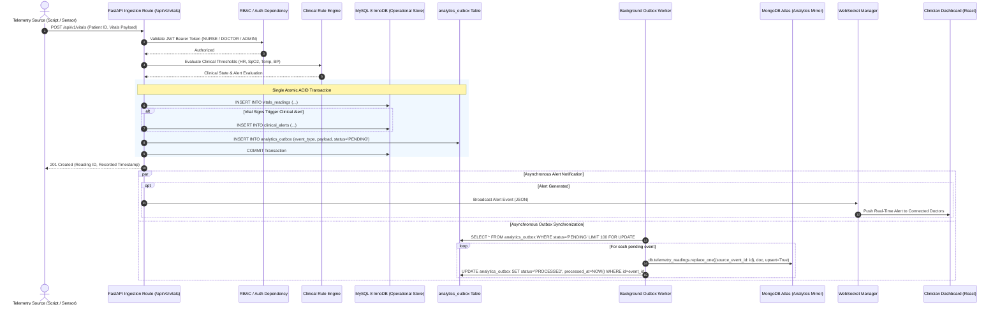
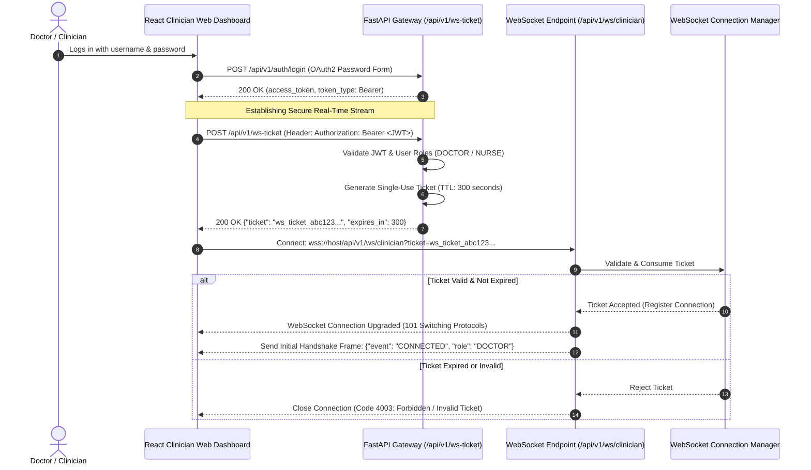
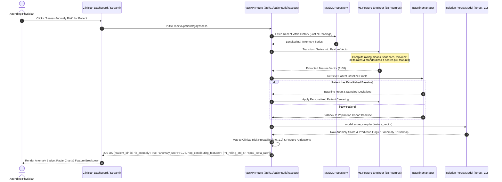

# 02. System Architecture & End-to-End Data Flow

**Document:** System Architecture Specification  
**Project:** AI-Powered Smart Health Monitoring System  
**Auditor & Architect:** Senior Software Architect & Lead Database Reliability Engineer  
**Date:** 14 October 2026  
**System Version:** 3.0.0  

---

## 1. Architectural Philosophy: The Polyglot Persistence Pattern

Modern healthcare telemetry platforms face two conflicting operational demands:
1. **High-Integrity Clinical Transactions:** Demographics, medical histories, device assignments, and alert lifecycle states require strict ACID transactions, declarative foreign key integrity, and non-repudiation.
2. **High-Throughput Time-Series Analytics:** Physiological telemetry streams (heart rate, SpO2, blood pressure, temperature) generate millions of data points requiring flexible indexing, high ingestion throughput, and complex multi-stage windowed aggregations across cohorts.

To resolve this impedance mismatch without sacrificing operational integrity, the Smart Health Monitoring System implements a **Polyglot Persistence Architecture** powered by the **Transactional Outbox Pattern**.

```mermaid
graph TD
    subgraph Clients ["Client Applications"]
        DoctorWeb["React Clinician Dashboard\n(apps/doctor_web)"]
        StreamlitUI["Streamlit Analytics Dashboard\n(dashboard/app.py)"]
        ExternalIngest["Telemetry Producers / Ingest Scripts\n(Kaggle Replay / Sensors)"]
        MobileApp["Patient Mobile App\n(Planned / External)"]
    end

    subgraph Gateway ["FastAPI Central Application Core (Port 8000)"]
        APIGateway["FastAPI API Gateway\n(Routes, OpenAPI, CORS, Logging)"]
        AuthMiddleware["OAuth2 & JWT Auth\n(4-Tier RBAC)"]
        MLService["ML Anomaly Engine\n(Isolation Forest v1.0.0)"]
        RuleEngine["Clinical Rule Engine\n(Thresholds & Alerts)"]
        WSManager["WebSocket Connection Manager\n(Ticket Authenticated)"]
        OutboxPoller["Background Outbox Worker\n(Async Polling & Sync)"]
    end

    subgraph RelationalDB ["Primary System of Record (Authoritative)"]
        MySQL[("MySQL 8.0 InnoDB\n15 Normalized Tables\nACID Transactions\nTriggers & Procedures")]
        OutboxTable[("analytics_outbox Table\n(Pending Event Buffer)")]
    end

    subgraph DocumentStore ["Analytical System of Engagement (Mirror)"]
        MongoDB[("MongoDB Atlas\nDocument Collections:\n- telemetry_readings\n- clinical_alerts")]
    end

    DoctorWeb -->|REST / Bearer JWT| APIGateway
    DoctorWeb -->|WSS Realtime Stream| WSManager
    StreamlitUI -->|Direct Read Access| MySQL
    StreamlitUI -->|Aggregation Pipelines| MongoDB
    ExternalIngest -->|POST /api/v1/vitals| APIGateway
    MobileApp -.->|Future Integration| APIGateway

    APIGateway --> AuthMiddleware
    AuthMiddleware --> RuleEngine
    AuthMiddleware --> MLService

    RuleEngine -->|Atomic ACID Write| MySQL
    RuleEngine -->|Atomic Event Enqueue| OutboxTable
    
    OutboxPoller -->|Poll Unprocessed Events| OutboxTable
    OutboxPoller -->|Idempotent Upsert (replace_one)| MongoDB
    OutboxPoller -->|Mark Event Processed| OutboxTable

    RuleEngine -->|Broadcast Alert Events| WSManager
    WSManager -->|Push Notifications| DoctorWeb
```

---

## 2. Component Roles & Architectural Responsibilities

### 2.1 FastAPI Core Application Gateway (`smart-health-monitoring`)
- **Technology:** FastAPI 0.115, Python 3.12, Uvicorn, Pydantic v2, SQLAlchemy 2.0.
- **Responsibilities:**
  - Exposes 59 REST endpoints organized under dual prefixes (`/api/v1/...` and root `/...`) for universal client compatibility.
  - Enforces OAuth2 Password Bearer authentication with HMAC-SHA256 signed JSON Web Tokens (JWT).
  - Enforces strict Role-Based Access Control (RBAC) across four security tiers: `ADMIN`, `DOCTOR`, `NURSE`, and `PATIENT`.
  - Performs declarative request validation and serialization via Pydantic schemas.
  - Manages database session lifecycles using dependency injection (`get_db`).

### 2.2 Relational Database: MySQL 8 InnoDB (`database/mysql/`)
- **Technology:** MySQL 8.0, InnoDB Storage Engine, Alembic version-controlled migrations.
- **Responsibilities:**
  - Serves as the authoritative, transactional source of truth for all critical system entities.
  - Enforces declarative referential integrity via Foreign Keys with explicit `ON DELETE CASCADE` / `ON DELETE RESTRICT` semantics.
  - Validates medical domain values at the database level using `CHECK` constraints.
  - Executes database-level business logic through 2 Views, 2 Stored Functions, 2 Stored Procedures (with atomic transaction savepoints), and 1 Audit Trigger.
  - Houses the `analytics_outbox` table to guarantee that telemetry ingestion and event publishing occur within a single atomic database transaction.

### 2.3 Document Database: MongoDB Atlas (`database/mongodb/`)
- **Technology:** MongoDB Atlas 7.0 / 8.0, PyMongo & Motor asynchronous drivers.
- **Responsibilities:**
  - Serves as the high-throughput analytical query store.
  - Stores denormalized document structures (`telemetry_readings` and `clinical_alerts`) optimized for analytical reads.
  - Maintains compound indexes supporting efficient range scans and cohort filtering.
  - Executes 7 production aggregation pipelines delivering cohort rollups, time-bucketed trends, and clinical alert triage without placing analytical query load on the primary relational database.

### 2.4 Machine Learning Anomaly Detection Package (`health_analysis`)
- **Technology:** scikit-learn 1.8.0, joblib, NumPy, Pandas, Isolation Forest algorithm.
- **Responsibilities:**
  - Implements unsupervised anomaly detection on multi-parameter vital signs.
  - Transforms raw vitals into a 38-feature vector including rolling statistical moments, delta rates, and z-score standardizations.
  - Incorporates personal historical baselines via the `BaselineManager` to prevent false alarms for patients with chronic atypical physiology (e.g. baseline tachycardia).
  - Returns continuous anomaly scores, binary anomaly flags, and top feature contribution rationales.

### 2.5 Clinician Web Workstation (`AdityaDhakad1404-frontend-dbms`)
- **Technology:** React 19, TypeScript 6.0, Vite 8.3, TailwindCSS, Axios, Node native test runner.
- **Responsibilities:**
  - Provides an interactive clinical user interface for attending physicians and triage nurses.
  - Connects to FastAPI via Bearer token authenticated REST calls.
  - Consumes live physiological alerts and vital telemetry updates via real-time WebSocket streams authenticated through short-lived single-use tickets.
  - Supports dual operational modes: Live Backend Mode (`VITE_USE_MOCK_DATA=false`) and Standalone Demo Mode.

### 2.6 Streamlit Analytics Dashboard (`dashboard/app.py`)
- **Technology:** Streamlit 1.40, Plotly, Pandas.
- **Responsibilities:**
  - Provides healthcare administrators and researchers with deep population-level analytics.
  - Renders 8 dedicated analytical modules: Patient Telemetry, Longitudinal Trends, Cohort Aggregation, Data Quality & Coverage, Clinical Alert Analytics, SQL vs. NoSQL Benchmark Explorer, Live Synchronization Health, and System Topology.
  - Offers interactive engine toggles between Live Database mode and Cached Benchmark artifacts.

### 2.7 Patient Mobile Application (Flutter)
- **Status:** **Planned / External (Not present in repository workspace).**
- **Documentation Integrity:** As verified during the system audit, mobile client code is not included in the repository. Telemetry generation is modeled through Kaggle dataset replay scripts and authenticated RESTful ingestion endpoints.

---

## 3. Detailed End-to-End Data Flows

### 3.1 Telemetry Ingestion & Transactional Outbox Flow

The primary data ingestion pipeline guarantees that vital readings are permanently recorded in the relational database before being mirrored to the document store.



### 3.2 Real-Time WebSocket Ticket Authentication Flow

To protect WebSocket streaming endpoints from credential leakage in URL query parameters, the system uses a **Short-Lived Ticket Exchange Protocol**:



### 3.3 Machine Learning Anomaly Assessment Flow



---

## 4. Consistency Guarantees & Distributed Architecture Trade-Offs

### 4.1 Why Distributed Two-Phase Commit (2PC) Was Deliberately Avoided
In a distributed cloud environment where MySQL runs locally or on a managed cloud VM and MongoDB is hosted on MongoDB Atlas, traditional distributed transactions (XA / 2PC) introduce severe operational risks:
- **Blocking Coordinator Problem:** If either network boundary experiences latency or a temporary partition, transactions block, holding locks on primary relational tables and starving incoming patient telemetry writes.
- **Latency Amplification:** Incurring two sequential network round-trips to MongoDB Atlas for every single sensor reading would degrade ingestion throughput by orders of magnitude.

### 4.2 The Implemented Guarantee: Dual-Layered Eventual Consistency
To ensure maximum availability, resilience, and operational safety:
1. **Intra-Relational Consistency (Strict ACID):** All clinical patient writes, vital sign insertions, and outbox event enqueue operations occur within a single atomic MySQL InnoDB transaction. If any constraint fails, the entire transaction rolls back cleanly.
2. **Inter-Database Consistency (Eventual Consistency with Idempotent Upserts):** The background outbox poller asynchronously reads pending events from `analytics_outbox` and mirrors them into MongoDB Atlas using `replace_one(filter={"source_event_id": event_id}, replacement=doc, upsert=True)`.
   - **Idempotency Guarantee:** If a network failure occurs during MongoDB synchronization and the worker retries the event, the upsert operation replaces the identical document without creating duplicates.
   - **Fault Tolerance:** If MongoDB Atlas becomes temporarily unreachable, incoming patient care and relational data storage proceed uninterrupted. Events accumulate safely in `analytics_outbox` and resume syncing immediately upon connection restoration.
