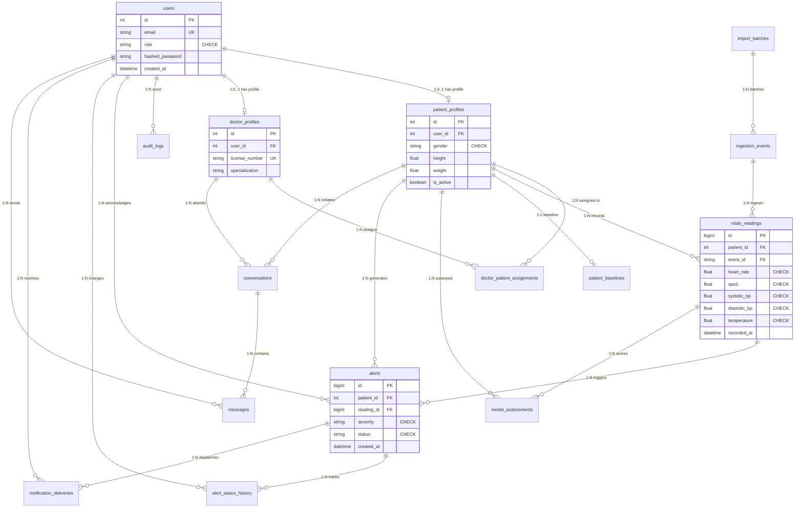

# 03. Dual-Engine Database Design & Procedural Specification

**Document:** Comprehensive Database Design Specification  
**Project:** AI-Powered Smart Health Monitoring System  
**Auditor & Database Architect:** Senior Software Architect & Lead Database Reliability Engineer  
**Date:** 14 October 2026  
**Relational Engine:** MySQL 8.0 InnoDB (Transactional System of Record)  
**Document Engine:** MongoDB Atlas 7.0 / 8.0 (Analytical System of Engagement)  

---

## 1. Relational Architecture (MySQL 8 InnoDB)

### 1.1 Entity-Relationship (ER / EER) Conceptual Diagram



### 1.2 Table Catalog & Structural Integrity

| Table Name | Primary Key | Foreign Keys & Cascades | Domain Constraints (`CHECK`) | Indexes & Optimizations |
|---|---|---|---|---|
| `import_batches` | `batch_id` (VARCHAR 36) | None | `total_records >= 0`, `imported_records >= 0` | Index on `imported_at DESC` |
| `users` | `id` (INT AUTO_INCREMENT) | None | `role IN ('ADMIN', 'DOCTOR', 'NURSE', 'PATIENT')` | Unique on `username`, Unique on `email` |
| `patient_profiles` | `id` (INT AUTO_INCREMENT) | `user_id` -> `users(id)` (`ON DELETE CASCADE`) | `gender IN ('MALE', 'FEMALE', 'OTHER')`, `height > 0`, `weight > 0` | Unique on `user_id`, Index on `created_at` |
| `doctor_profiles` | `id` (INT AUTO_INCREMENT) | `user_id` -> `users(id)` (`ON DELETE CASCADE`) | `license_number` NOT NULL | Unique on `user_id`, Unique on `license_number` |
| `doctor_patient_assignments` | `id` (INT AUTO_INCREMENT) | `doctor_id` -> `doctor_profiles(id)` (`ON DELETE RESTRICT`), `patient_id` -> `patient_profiles(id)` (`ON DELETE CASCADE`) | None | Unique composite `(doctor_id, patient_id)` |
| `ingestion_events` | `event_id` (VARCHAR 64) | `batch_id` -> `import_batches(batch_id)` (`ON DELETE SET NULL`) | `source IN ('KAGGLE', 'DEVICE_SIMULATOR', 'REST_API')` | Unique on `event_id`, Index on `received_at` |
| `vitals_readings` | `id` (BIGINT AUTO_INCREMENT) | `patient_id` -> `patient_profiles(id)` (`ON DELETE CASCADE`), `event_id` -> `ingestion_events(event_id)` (`ON DELETE SET NULL`) | `heart_rate > 0 AND heart_rate < 300`, `spo2 >= 50 AND spo2 <= 100`, `systolic_bp >= 40 AND systolic_bp <= 260`, `diastolic_bp >= 30 AND diastolic_bp <= 180`, `temperature >= 30.0 AND temperature <= 45.0` | Covering Composite Index `(patient_id, recorded_at DESC)`, Composite Index `(patient_id, is_abnormal)` |
| `alert_rules` | `id` (INT AUTO_INCREMENT) | None | `metric IN ('HEART_RATE', 'SPO2', 'SYSTOLIC_BP', 'DIASTOLIC_BP', 'TEMPERATURE')`, `severity IN ('LOW', 'MEDIUM', 'HIGH', 'CRITICAL')` | Index on `(metric, is_active)` |
| `patient_baselines` | `id` (INT AUTO_INCREMENT) | `patient_id` -> `patient_profiles(id)` (`ON DELETE CASCADE`) | `baseline_heart_rate > 0`, `baseline_spo2 > 0` | Unique on `patient_id` |
| `model_assessments` | `id` (BIGINT AUTO_INCREMENT) | `patient_id` -> `patient_profiles(id)` (`ON DELETE CASCADE`), `reading_id` -> `vitals_readings(id)` (`ON DELETE SET NULL`) | `anomaly_score >= 0.0 AND anomaly_score <= 1.0` | Index on `(patient_id, assessed_at DESC)` |
| `alerts` | `id` (BIGINT AUTO_INCREMENT) | `patient_id` -> `patient_profiles(id)` (`ON DELETE CASCADE`), `reading_id` -> `vitals_readings(id)` (`ON DELETE SET NULL`), `acknowledged_by` -> `users(id)` (`ON DELETE SET NULL`) | `severity IN ('LOW', 'MEDIUM', 'HIGH', 'CRITICAL')`, `status IN ('ACTIVE', 'ACKNOWLEDGED', 'RESOLVED', 'DISMISSED')` | Composite Index `(patient_id, status)`, Index on `(created_at DESC)` |
| `alert_status_history` | `id` (BIGINT AUTO_INCREMENT) | `alert_id` -> `alerts(id)` (`ON DELETE CASCADE`), `changed_by` -> `users(id)` (`ON DELETE SET NULL`) | None | Index on `(alert_id, changed_at)` |
| `notification_deliveries` | `id` (BIGINT AUTO_INCREMENT) | `alert_id` -> `alerts(id)` (`ON DELETE CASCADE`), `recipient_id` -> `users(id)` (`ON DELETE CASCADE`) | `channel IN ('WEBSOCKET', 'PUSH', 'SMS', 'EMAIL')`, `status IN ('PENDING', 'SENT', 'FAILED')` | Index on `(alert_id, status)` |
| `conversations` | `id` (INT AUTO_INCREMENT) | `patient_id` -> `patient_profiles(id)` (`ON DELETE CASCADE`), `doctor_id` -> `doctor_profiles(id)` (`ON DELETE RESTRICT`) | None | Composite Index `(patient_id, doctor_id)` |
| `messages` | `id` (BIGINT AUTO_INCREMENT) | `conversation_id` -> `conversations(id)` (`ON DELETE CASCADE`), `sender_id` -> `users(id)` (`ON DELETE CASCADE`) | `LENGTH(content) > 0` | Index on `(conversation_id, created_at ASC)` |
| `audit_logs` | `id` (BIGINT AUTO_INCREMENT) | `user_id` -> `users(id)` (`ON DELETE SET NULL`) | None | Index on `(created_at DESC)`, Index on `(action, resource_type)` |
| `analytics_outbox` | `id` (BIGINT AUTO_INCREMENT) | None | `status IN ('PENDING', 'PROCESSED', 'FAILED')` | Index on `(status, created_at ASC)` |

---

### 1.3 Formal Relational Normalization Analysis (3NF / BCNF)

To eliminate update, insertion, and deletion anomalies, the relational schema enforces strict Third Normal Form (3NF) and Boyce-Codd Normal Form (BCNF):

1. **First Normal Form (1NF) Compliance:**
   - Every column contains exclusively atomic values (e.g., vital signs are stored in dedicated numerical columns `heart_rate`, `spo2`, `systolic_bp`, rather than comma-separated strings or JSON arrays).
   - Each table possesses an unambiguous Primary Key.

2. **Second Normal Form (2NF) Compliance:**
   - All composite tables (e.g. `doctor_patient_assignments` on `(doctor_id, patient_id)`) contain non-key attributes that are fully functionally dependent on the entire composite candidate key, with zero partial dependencies.

3. **Third Normal Form (3NF) & Boyce-Codd Normal Form (BCNF) Compliance:**
   - **User Demographics & Credentials:** Authentication details (`users`) are cleanly decoupled from clinical profiles (`patient_profiles` and `doctor_profiles`). If a doctor's specialty or office location changes, it updates exactly one row in `doctor_profiles` without touching user authentication or clinical care records.
   - **Device Ingestion & Vitals Isolation:** Raw batch metadata (`import_batches`) is decoupled from individual sensor events (`ingestion_events`), which are in turn decoupled from physiological readings (`vitals_readings`). If a batch import fails or is archived, the vitals model does not store transitive batch metadata.
   - **Functional Dependency Proof ($X \rightarrow Y \implies X$ is a Superkey):** In all tables, every non-trivial functional dependency has a determinant that is a candidate key. For example, in `vitals_readings`:
     $$\text{id} \rightarrow (\text{patient\_id}, \text{recorded\_at}, \text{heart\_rate}, \text{spo2}, \text{systolic\_bp}, \text{diastolic\_bp}, \text{temperature})$$
     Since $\text{id}$ is the primary key and superkey, BCNF is preserved throughout the database.

---

### 1.4 Database-Side Procedural Logic

To offload computational overhead and guarantee atomic consistency directly inside the database engine, MySQL implements stored functions, views, stored procedures, and triggers:

#### 1.3.1 Relational Views
1. **`v_latest_patient_vitals`:** Resolves the most recent vital sign reading for every active patient using an inner join against a grouped subquery on `MAX(recorded_at)`.
2. **`v_patient_active_alerts`:** Joins active clinical alerts with patient demographic profiles and attending doctor assignments, providing a denormalized live clinical triage view for hospital staff.

#### 1.3.2 User-Defined Stored Functions
1. **`fn_calculate_bmi(weight_kg DECIMAL(5,2), height_cm DECIMAL(5,2)) RETURNS DECIMAL(5,2)`:**
   - Calculates Body Mass Index: $\text{BMI} = \frac{\text{weight\_kg}}{(\text{height\_cm} / 100)^2}$.
   - Contains defensive boundary checks returning `NULL` if height or weight is non-positive.
2. **`fn_calculate_fever_category(temp_celsius DECIMAL(4,2)) RETURNS VARCHAR(20)`:**
   - Classifies clinical temperature: `HYPOTHERMIA` ($< 35.0^\circ\text{C}$), `NORMAL` ($35.0^\circ\text{C} - 37.5^\circ\text{C}$), `LOW_GRADE_FEVER` ($37.6^\circ\text{C} - 38.3^\circ\text{C}$), and `HIGH_FEVER` ($> 38.3^\circ\text{C}$).

#### 1.3.3 Stored Procedures & Transactional Safety
1. **`sp_acknowledge_alert(IN p_alert_id BIGINT, IN p_user_id INT, IN p_notes TEXT)`:**
   - Validates that the alert exists and is currently in `ACTIVE` state.
   - Updates alert status to `ACKNOWLEDGED` and sets `acknowledged_at = NOW()` and `acknowledged_by = p_user_id`.
   - Records acknowledgment notes.
2. **`sp_evaluate_patient_alerts(IN p_patient_id INT)`:**
   - Uses a **SQL Cursor** (`DECLARE cur_vitals CURSOR FOR...`) to iterate across un-evaluated readings for a given patient, testing each vital sign against active rules in `alert_rules` and inserting new alerts.
3. **`sp_safe_patient_discharge(IN p_patient_id INT, IN p_doctor_id INT, OUT p_success BOOLEAN, OUT p_message VARCHAR(255))`:**
   - Demonstrates **ACID Transactions with Named Savepoints**:
     ```sql
     START TRANSACTION;
     SAVEPOINT before_discharge;
     -- Check if patient has any unresolved CRITICAL or HIGH alerts
     SELECT COUNT(*) INTO active_critical_count FROM alerts 
     WHERE patient_id = p_patient_id AND severity IN ('HIGH', 'CRITICAL') AND status = 'ACTIVE';
     
     IF active_critical_count > 0 THEN
         ROLLBACK TO SAVEPOINT before_discharge;
         SET p_success = FALSE;
         SET p_message = 'Cannot discharge patient with active CRITICAL or HIGH alerts.';
         COMMIT;
     ELSE
         -- Deactivate active doctor assignments and update patient status
         UPDATE doctor_patient_assignments SET is_active = FALSE WHERE patient_id = p_patient_id;
         UPDATE patient_profiles SET is_active = FALSE WHERE id = p_patient_id;
         SET p_success = TRUE;
         SET p_message = 'Patient discharged safely.';
         COMMIT;
     END IF;
     ```

#### 1.3.4 Database Triggers
1. **`trg_alert_status_history_after_update`:**
   - Triggered `AFTER UPDATE ON alerts`.
   - Automatically detects status changes (`IF OLD.status != NEW.status`) and inserts an immutable audit record into `alert_status_history` capturing `alert_id`, `old_status`, `new_status`, `changed_by`, and `changed_at = NOW()`.

---

## 2. Document Data Modeling (MongoDB Atlas)

MongoDB Atlas functions as the high-throughput analytical query mirror. Schemas and aggregation logic are defined under `database/mongodb/`.

### 2.1 Collection Schemas & Data Types

#### Collection: `telemetry_readings`
Optimized for high-throughput time-series ingestion and multi-parameter windowed queries.
```json
{
  "_id": {"$oid": "670c79..."},
  "source_event_id": "evt_kaggle_p1_0001",
  "source_reading_id": 1042,
  "patient_id": 1,
  "recorded_at": {"$date": "2026-10-14T08:30:00Z"},
  "vitals": {
    "heart_rate": 78.5,
    "spo2": 98.0,
    "blood_pressure": {
      "systolic": 122.0,
      "diastolic": 81.0
    },
    "temperature": 36.8
  },
  "is_abnormal": false,
  "data_source": "KAGGLE",
  "synced_at": {"$date": "2026-10-14T08:30:05Z"}
}
```

#### Collection: `clinical_alerts`
Stores pre-aggregated alerts with embedded patient and clinical context.
```json
{
  "_id": {"$oid": "670c80..."},
  "source_alert_id": 42,
  "patient_id": 1,
  "patient_name": "John Doe",
  "severity": "HIGH",
  "status": "ACTIVE",
  "metric": "SPO2",
  "trigger_value": 89.0,
  "threshold_value": 92.0,
  "created_at": {"$date": "2026-10-14T09:15:00Z"},
  "acknowledged_at": null,
  "acknowledged_by": null
}
```

### 2.2 Indexing Strategy in MongoDB

1. **`telemetry_readings` Indexes:**
   - `{"patient_id": 1, "recorded_at": -1}`: Compound index enabling fast chronological range scans and latest-vitals lookups for individual patients.
   - `{"source_event_id": 1}`: Unique sparse index guaranteeing idempotency during outbox synchronization.
   - `{"recorded_at": -1}`: Single-field index supporting time-window filtering across the entire patient population.
2. **`clinical_alerts` Indexes:**
   - `{"patient_id": 1, "status": 1, "severity": 1}`: Compound index accelerating clinical alert triage workflows.
   - `{"created_at": -1}`: Enables real-time alert feed ordering.

---

### 2.3 The 7 Production MongoDB Aggregation Pipelines

Implemented in `database/mongodb/analytics/pipelines.py`, these pipelines deliver sophisticated analytical transformations directly in the database engine:

1. **`build_dataset_overview_pipeline()`:**
   - Stages: `$facet` executing parallel sub-pipelines computing total readings, distinct patient counts (`$addToSet`), global min/max recording timestamps, and overall abnormal reading ratios.
2. **`build_patient_vitals_summary_pipeline(patient_id)`:**
   - Stages: `$match` by `patient_id` $\rightarrow$ `$group` computing min, max, average, and standard deviation for each vital parameter (`$stdDevSamp`), plus total abnormal flags.
3. **`build_time_bucketed_vitals_pipeline(patient_id, bucket_hours)`:**
   - Stages: `$match` $\rightarrow$ `$project` extracting date-truncation expressions $\rightarrow$ `$group` by bucket interval, computing chronological average vital signs and reading counts.
4. **`build_patient_history_pipeline(patient_id, start_date, end_date, limit, skip)`:**
   - Stages: `$match` with temporal bounding $\rightarrow$ `$sort` by `recorded_at DESC` $\rightarrow$ `$skip` and `$limit` for deterministic pagination.
5. **`build_source_provenance_pipeline()`:**
   - Stages: `$group` by `data_source` computing ingest counts, first seen timestamp, last seen timestamp, and error percentages.
6. **`build_alert_summary_pipeline()`:**
   - Stages: `$group` by `(severity, status)` computing clinical queue statistics, average resolution times, and outstanding active critical alerts.
7. **`build_data_quality_pipeline()`:**
   - Stages: Multi-faceted pipeline auditing missing physiological values, out-of-range sensor readings, and ingestion gap anomalies.

---

## 3. Structural Rationale: Embedding vs. Referencing

| Consideration | Relational Schema (MySQL) | Document Schema (MongoDB) | Architectural Justification |
|---|---|---|---|
| **Vitals vs. Patients** | Normalized Foreign Key (`patient_id` references `patient_profiles.id`) | Referenced by `patient_id`; patient demographic context omitted | Telemetry streams arrive continuously. Embedding an unbounded array of readings into a single patient document would quickly breach MongoDB's 16MB document limit and cause severe write lock contention. |
| **Blood Pressure Values** | Discrete columns (`systolic_bp`, `diastolic_bp`) | Embedded subdocument (`vitals.blood_pressure.systolic`) | Blood pressure is inherently a paired metric. In MongoDB, grouping them in a subdocument preserves conceptual cohesion while allowing direct field indexing. |
| **Alert Status History** | Normalized audit table (`alert_status_history`) | Embedded status transitions array in `clinical_alerts` | Alerts undergo a small, bounded number of state transitions (Active $\rightarrow$ Acknowledged $\rightarrow$ Resolved). Embedding bounded history avoids cross-collection joins during UI display. |
