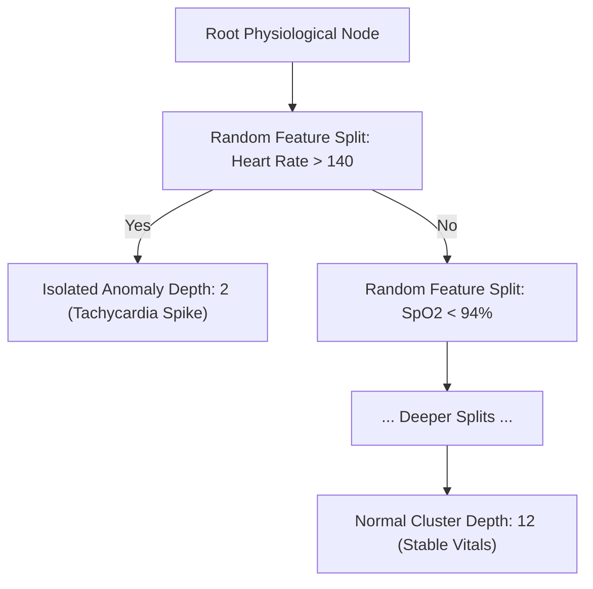
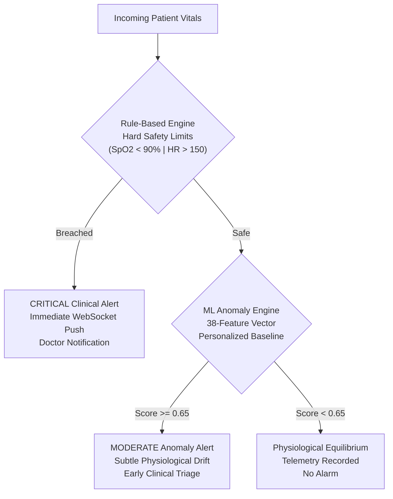

# 05. Machine Learning Technical Documentation & Anomaly Engine

**Document:** Machine Learning Technical Specification  
**Project:** AI-Powered Smart Health Monitoring System  
**Package:** `health_analysis` (Integrated from teammate repository `HarnoorKant/Smart-Health-Monitoring-System`)  
**Auditor & ML Engineer:** Senior ML Engineer & Software Architect  
**Date:** 14 October 2026  
**Artifact Model:** `models/iforest_v1/iforest_model.joblib` (Isolation Forest v1.0.0)  

---

## 1. Algorithmic Foundation: Isolation Forest

The machine learning subsystem implements an unsupervised physiological anomaly detection architecture powered by the **Isolation Forest** (`sklearn.ensemble.IsolationForest`) algorithm.

### 1.1 Mathematical Principle
Unlike distance-based (k-NN) or density-based (LOF) anomaly detection algorithms that suffer from the curse of dimensionality and high computational complexity ($\mathcal{O}(n^2)$), Isolation Forest exploits two fundamental properties of anomalous observations:
1. They are few in number (minority class).
2. They possess attribute-value distributions distinctly different from normal physiological equilibrium.

The algorithm constructs an ensemble of $T$ randomized isolation trees (iTrees). In each tree, partitions are generated by randomly selecting an engineered physiological feature $q$ and choosing a random split point $p$ between the feature's minimum and maximum values:
$$p \sim \text{Uniform}(\min(q), \max(q))$$

Because anomalies deviate from typical cluster centers, they are isolated at significantly shallower tree depths:

The anomaly score $s(x, n)$ for an observation $x$ over a dataset of $n$ instances is given by:
$$s(x, n) = 2^{-\frac{\mathbb{E}(h(x))}{c(n)}}$$
Where:
- $h(x)$ is the path length (number of edges traversed from root to leaf node).
- $\mathbb{E}(h(x))$ is the average path length across all isolation trees in the ensemble.
- $c(n)$ is the average path length of an unsuccessful search in a Binary Search Tree (BST), defined as:
  $$c(n) = 2 \ln(n - 1) + 0.5772156649 \text{ (Euler-Mascheroni constant)} - \frac{2(n - 1)}{n}$$

### 1.2 Model Hyperparameters
As serialized in `models/iforest_v1/config.json`:
- `n_estimators`: 100 decision trees.
- `contamination`: 0.05 (calibrated 5% clinical anomaly prior).
- `max_samples`: `auto` ($\min(256, n)$).
- `bootstrap`: `False` (sampling without replacement).
- `random_state`: 42 (guaranteeing deterministic reproducibility).

---

## 2. Feature Engineering Pipeline (38 Features)

Raw vital signs (Heart Rate, SpO2, Systolic BP, Diastolic BP, Temperature) undergo multi-scale feature transformation in `packages/health_analysis/features.py`. The resulting 38-dimensional vector captures instantaneous values, longitudinal volatility, and cross-metric correlations:

| Feature Category | Dimension | Mathematical Formulation / Description | Clinical Significance |
|---|---|---|---|
| **Raw Instantaneous Values** | 5 | $x_t \in \{\text{HR}, \text{SpO}_2, \text{SBP}, \text{DBP}, \text{TEMP}\}$ | Current physiological state |
| **Rolling Means ($\mu_{w}$)** | 10 | $\mu_{w}(t) = \frac{1}{w}\sum_{i=0}^{w-1} x_{t-i}$ for $w \in \{5, 10\}$ | Short-term and medium-term physiological baseline |
| **Rolling Volatility ($\sigma_{w}$)** | 10 | $\sigma_{w}(t) = \sqrt{\frac{1}{w}\sum_{i=0}^{w-1} (x_{t-i} - \mu_{w}(t))^2}$ for $w \in \{5, 10\}$ | Telemetry instability, arrhythmia, or temperature swings |
| **Rolling Extremes ($\min_w, \max_w$)** | 5 | $\max_{w}(t) - \min_{w}(t)$ for $w = 10$ | Peak-to-peak physiological excursion |
| **Temporal Delta Rates ($\Delta x$)** | 4 | $\Delta x_t = x_t - x_{t-1}$ | Rate-of-change (e.g. precipitous blood pressure crash) |
| **Personalized Z-Scores ($Z_{\text{base}}$)** | 4 | $Z_i = \frac{x_i - \mu_{\text{patient}}}{\sigma_{\text{patient}}}$ | Patient-centric deviation normalized against personal history |

---

## 3. Patient Personalization: The `BaselineManager`

A primary failure mode of automated clinical anomaly detection is **alarm fatigue** caused by population-wide thresholds. A resting heart rate of 50 bpm is highly abnormal for a sedentary patient with heart failure, but perfectly healthy for a marathon runner.

To resolve this, the system incorporates the **`BaselineManager`** (`packages/health_analysis/baselines.py`):
1. **Historical Calibration:** When a patient is monitored over time, the `BaselineManager` aggregates their stable vitals and persists a `patient_baselines` record in MySQL.
2. **Personalized Normalization:** During feature extraction, vital parameters are dynamically centered around the patient's individual mean ($\mu_p$) and scaled by their individual variance ($\sigma_p^2$).
3. **Fallback Hierarchy:** If a newly admitted patient lacks an individual baseline:
   $$\text{Baseline}(p) = \begin{cases} \text{Personal Profile}(p) & \text{if } n_{\text{readings}} \ge 30 \\ \text{Cohort Baseline}(\text{age, gender}) & \text{if } 5 \le n_{\text{readings}} < 30 \\ \text{Global Population Norms} & \text{otherwise} \end{cases}$$

---

## 4. Interaction with Rule-Based Clinical Alerts

The machine learning engine does not operate in a vacuum; it forms the upper layer of a **Defense-in-Depth Clinical Triage Architecture**:

1. **Rule Engine (Deterministic Safety Net):** Guarantees zero false negatives on acute, life-threatening breaches of clinical boundaries (e.g. oxygen saturation dropping below 90%).
2. **ML Engine (Proactive Early Warning):** Identifies subtle, multi-variate correlations that individually evade single-parameter thresholds (e.g. heart rate steadily rising while diastolic blood pressure drifts downwards—a classic precursor to septic shock).

---

## 5. Medical Device & Diagnostic Safety Disclaimer

> [!CAUTION]
> **REGULATORY & MEDICAL SAFETY NOTICE:**
> The machine learning model integrated within this system is an **unsupervised statistical anomaly detection algorithm** designed exclusively for:
> 1. Educational demonstration and academic coursework verification (Digital Assignment DA3).
> 2. Clinical decision-support triage assistance and prioritized queue sorting.
> 
> **It is NOT an FDA-cleared, CE-marked, or SaMD (Software as a Medical Device) diagnostic tool.** It does NOT predict medical diagnoses, disease etiologies, or treatment protocols. All clinical alerts generated by the model require independent evaluation and verification by a licensed medical practitioner prior to clinical intervention.

---

## 6. Dataset Availability & Practical Constraints

- **Source Dataset:** Kaggle Healthcare Telemetry Dataset (`E:\kaggle_health_dataset.csv`, 1,500 readings across 5 cohorts).
- **Feature Completeness:** The Kaggle dataset provides core physiological metrics (`Heart Rate`, `Blood Pressure`, `Respiratory Rate`, `Body Temperature`, `Oxygen Saturation`).
- **Cold-Start Handling:** In scenarios where a patient's historical window is shorter than the rolling window size ($w=10$), the feature engineering pipeline pads initial values with cohort defaults rather than fabricating synthetic data or failing with exceptions.
