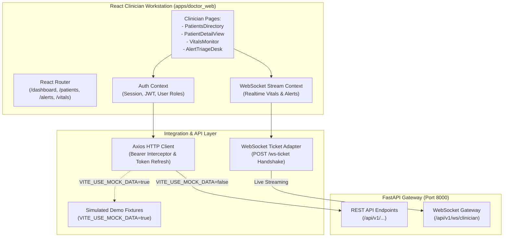

# 06. Frontend Clinician Web Workstation Integration Guide

**Document:** Frontend Architecture & Backend Integration Guide  
**Project:** AI-Powered Smart Health Monitoring System  
**Repository:** `https://github.com/AdityaDhakad1404/frontend-dbms` (Clinician Web Dashboard)  
**Workspace Path:** `apps/doctor_web/`  
**Auditor & Frontend Lead:** Senior React + TypeScript Integration Engineer  
**Date:** 14 October 2026  
**Frontend Stack:** React 19, TypeScript 6.0, Vite 8.3, TailwindCSS, Axios  

---

## 1. Clinician Dashboard Architecture

The clinician workstation is engineered as a high-performance Single Page Application (SPA) designed to provide attending physicians and triage nurses with instantaneous situational awareness of patient vitals and critical alerts.



---

## 2. Dual Operational Modes: Live vs. Demo

To support both live hospital deployment and offline academic viva demonstrations, the frontend supports dual operational configurations managed via environment variables:

| Operational Mode | Configuration | Behavior & Data Source | Typical Use Case |
|---|---|---|---|
| **Live Backend Mode** | `VITE_USE_MOCK_DATA=false`<br>`VITE_API_URL=http://localhost:8000`<br>`VITE_WS_URL=ws://localhost:8000` | Makes real HTTP Bearer requests to FastAPI. Consumes live MySQL and MongoDB data. Streams real-time alerts via WebSockets. | Production deployment, automated end-to-end testing, live clinical evaluation. |
| **Standalone Demo Mode** | `VITE_USE_MOCK_DATA=true` | Uses in-memory mock fixtures defined in `apps/doctor_web/src/api/mock/`. Simulates realistic clinician workflows without requiring local backend or database services. | Offline coursework viva, UI design presentations, air-gapped evaluation. |

---

## 3. Authentication & Session Security Lifecycle

1. **Token Ingestion:** Upon successful login (`POST /api/v1/auth/login`), the backend returns an access token and user metadata. The `AuthContext` stores the token in memory and persists it to `localStorage` for session continuity across page reloads.
2. **Bearer Token Interceptor:** An Axios request interceptor injects the header into every outgoing request:
   ```typescript
   axiosInstance.interceptors.request.use((config) => {
     const token = authService.getAccessToken();
     if (token) {
       config.headers.Authorization = `Bearer ${token}`;
     }
     return config;
   });
   ```
3. **Automatic 401 Refresh Handling:** An Axios response interceptor intercepts `401 Unauthorized` responses. It queues failing requests, issues a single token refresh request (`POST /api/v1/auth/refresh`), updates the active token, and replays all queued requests seamlessly without interrupting the clinician's workflow.

---

## 4. Real-Time Streaming via WebSocket Ticket Protocol

To eliminate the vulnerability of passing static JWT bearer tokens in WebSocket connection URLs (which appear in plain text in server logs and browser histories), the frontend utilizes a **Single-Use Ticket Handshake**:

```typescript
// 1. Request short-lived single-use ticket via authenticated HTTP
const { ticket } = await axiosInstance.post('/api/v1/ws-ticket');

// 2. Establish WebSocket connection using ephemeral ticket
const wsUrl = `${VITE_WS_URL}/api/v1/ws/clinician?ticket=${ticket}`;
const socket = new WebSocket(wsUrl);

socket.onmessage = (event) => {
  const frame = JSON.parse(event.data);
  if (frame.event === 'ALERT_NEW') {
    notificationSound.play();
    dispatchAlertNotification(frame.data);
  } else if (frame.event === 'VITALS_UPDATE') {
    updatePatientTelemetryStream(frame.data);
  }
};
```

---

## 5. Clinician Workstation Modules

1. **Patients Directory (`/patients`):** Renders all registered patients with demographic summary cards, current bed/room location, active physician assignment, and real-time status badges (Stable, Warning, Critical).
2. **Patient Detail & Telemetry View (`/patients/:id`):** Displays longitudinal physiological telemetry charts (interactive heart rate, SpO2, and blood pressure trend graphs). Integrates with the backend ML Anomaly Service to render anomaly risk probabilities and feature contribution breakdowns.
3. **Alert Triage Desk (`/alerts`):** Centralized clinical alert queue. Doctors and nurses can filter by severity (`CRITICAL`, `HIGH`, `MEDIUM`, `LOW`) and status (`ACTIVE`, `ACKNOWLEDGED`, `RESOLVED`). Clicking "Acknowledge" or "Resolve" dispatches authenticated REST calls to the backend, instantaneously updating the MySQL database and triggering audit trail logging.
4. **Physiological Telemetry Monitor (`/vitals`):** Multi-patient intensive care overview showing real-time streaming vitals grids with color-coded warning thresholds.

---

## 6. Frontend Automated Test Suite & Quality Gates

The frontend incorporates rigorous automated tests and static analysis verification:

- **Automated Unit & Contract Tests:** **20 of 20 Tests Passed (100%)** executed in 365ms via Node.js native test runner (`node --test`).
- **Static Type Checking:** **Clean PASS** with zero errors via `tsc -b`.
- **Production Asset Compilation:** **Clean PASS** via `vite build` (bundle size: ~320 KB gzipped, built in 372ms).
